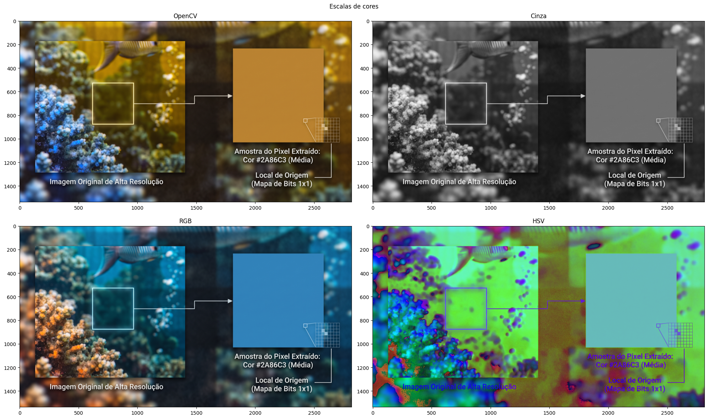
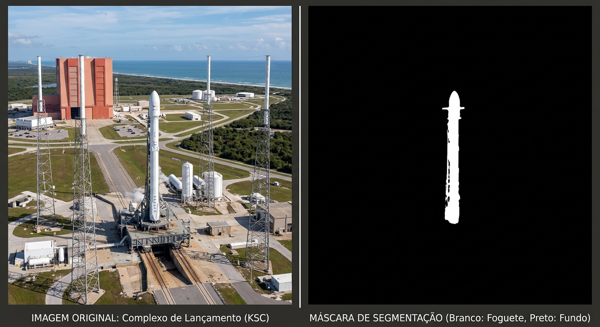

# Fundamentos de Imagens Digitais

---

### 🛠️ Ferramentas Utilizadas

---

<div style="inline-flex">
<a href="https://colab.new" target="_blank"></a>


</div>

---

### 📖 1. O que é uma Imagem Digital?

---

<p>
Toda imagem digital é composta por <strong>pixels</strong> (<em>picture elements</em>), a menor unidade de representação visual computacional. Na prática, <strong>uma imagem é representada na memória como uma matriz (ou tensor) de valores numéricos</strong>, em que cada posição guarda a intensidade luminosa ou de cor daquele ponto.
</p>


Para manipular imagens via código, precisamos compreender quatro conceitos fundamentais: **resolução**, **canais e escalas de cores**, **filtros** e **máscaras**.

#### 📐 Resolução

Consiste nas dimensões espaciais da imagem ($\text{altura} \times \text{largura}$), representando a quantidade total de pixels organizados na matriz.

```text
Maior resolução → Maior quantidade de pixels → Maior nível de detalhes visuais.
```

* **Exemplo prático:** Uma imagem **Full HD** ($1920 \times 1080\text{ pixels} \approx 2{,}07\text{ Mpixels}$) versus uma **Ultra HD 4K** ($3840 \times 2160\text{ pixels} \approx 8{,}29\text{ Mpixels}$). Qual delas preserva mais detalhes ao darmos zoom?

---

### 🎨 2. Canais e Escalas de Cores

---

Os **canais** representam a quantidade de camadas que compõem a matriz da imagem. Eles armazenam propriedades como cor, luminosidade e transparência em cada pixel. Em imagens padrão de 8 bits por canal (`uint8`), cada valor varia de **0** (ausência de intensidade) a **255** (intensidade máxima).

A forma como esses canais são combinados define a **escala (ou espaço) de cores**:

=== "RGB / BGR"

    * **Canais:** **R** (*Red*), **G** (*Green*), **B** (*Blue*)
    * **Descrição / Aplicação:** Padrão em telas, monitores e fotografia digital.
    * **Atenção no OpenCV:** Por razões históricas, o OpenCV lê imagens no formato **BGR** (Azul, Verde, Vermelho). Para exibir as cores corretas no `matplotlib`, convertemos de BGR para RGB.

=== "HSV / HSB"

    * **Canais:** **H** (*Hue* / Matiz), **S** (*Saturation* / Saturação), **V/B** (*Value* / *Brightness* / Brilho)
    * **Descrição / Aplicação:** Separa a cor pura (Matiz) da vivacidade (Saturação) e da iluminação (Valor). Essencial em editores de imagem para alterar a **saturação** sem distorcer as cores originais.

=== "Grayscale"

    * **Canais:** **L** (*Luminance* / Intensidade)
    * **Descrição / Aplicação:** Canal único (matriz 2D). Muito utilizado em fotografia P&B, detecção de bordas e pré-processamento leve.

=== "CMYK"

    * **Canais:** **C** (*Cyan*), **M** (*Magenta*), **Y** (*Yellow*), **K** (*Black*)
    * **Descrição / Aplicação:** Modelo subtrativo voltado para impressão gráfica e editorial.

=== "HSL"

    * **Canais:** **H** (*Hue*), **S** (*Saturation*), **L** (*Lightness*)
    * **Descrição / Aplicação:** Desenvolvimento web (CSS) e design de interfaces (UI/UX).

=== "CIE Lab"

    * **Canais:** **L** (*Lightness*), **a** (eixo Verde-Vermelho), **b** (eixo Azul-Amarelo)
    * **Descrição / Aplicação:** Gerenciamento profissional de cor e aproximação da percepção visual humana.

=== "RGBA / HSLA"

    * **Canais:** Canais base + **A** (*Alpha*)
    * **Descrição / Aplicação:** Extensão que adiciona um quarto canal para controle de opacidade/transparência.

=== "YUV / YCbCr"

    * **Canais:** **Y** (*Luma*), **U/Cb** (*Chroma Azul*), **V/Cr** (*Chroma Vermelho*)
    * **Descrição / Aplicação:** Separa a luminosidade da crominância. Usado em transmissão de vídeo e compressão JPEG.



<p style="text-align:center"><strong>Observação:</strong> Maior quantidade de canais → Maior volume de informação por pixel → Maior consumo de memória e processamento.</p>

---

### 🎛️ 3. Filtros, Ajustes e Máscaras

---

Em processamento de imagens, **filtros** são operações matemáticas aplicadas sobre os pixels para modificar a aparência da imagem — seja ajustando cores e iluminação, suavizando ruídos ou destacando contornos.

=== "Ajuste Tonal & Cor"

    Operações ponto a ponto que alteram o brilho, o contraste e a vivacidade das cores:

    * **Brilho e Contraste:** Transformação linear dada por $g(x,y) = \alpha \cdot f(x,y) + \beta$, onde $\alpha$ (*alpha*) controla o **contraste** (amplitude entre claros e escuros) e $\beta$ (*beta*) soma ou subtrai **brilho**.
    * **Matiz / Saturação (HSV Shift):** Altera a roda de cores (Matiz) ou a intensidade/pureza das cores (**Saturação**).
    * **Equalização de Histograma:** Redistribui as intensidades dos pixels para maximizar o contraste global.
    * **Ajuste de Gamma (Correção Gamma):** Mapeia a luminância de forma não linear ($g(x,y) = f(x,y)^{\gamma}$) para corrigir exposição.

=== "Filtros Espaciais (Borramento e Suavização)"

    Modificam o valor de cada pixel calculando uma combinação dos seus pixels vizinhos (convolução):

    * **Borramento por Média (Box Blur):** Substitui o valor do pixel pela média simples dos vizinhos, provocando um borramento uniforme.
    * **Suavização Gaussiana (Gaussian Blur):** Aplica uma matriz de pesos baseada na distribuição gaussiana para suavizar a imagem de forma natural e reduzir ruídos de alta frequência.
    * **Filtro de Mediana (Median Blur):** Substitui o pixel pela mediana da vizinhança. Excelente para remover ruídos do tipo *"sal e pimenta"* preservando contornos.
    * **Filtro Bilateral:** Suaviza regiões internas mantendo as bordas nítidas.
    * **Nitidez (Sharpening / Unsharp Mask):** Realça bordas e detalhes finos aumentando o contraste entre pixels adjacentes.

=== "Detecção de Bordas"

    * **Sobel:** Calcula o gradiente de intensidade nas direções horizontal ($G_x$) e vertical ($G_y$), combinando-os em $G = \sqrt{G_x^2 + G_y^2}$ para destacar transições de brilho.
    * **Canny:** Algoritmo multi-estágio de alta precisão para extração de contornos finos (usa suavização gaussiana, gradiente, supressão de não-máximos e histerese).
    * **Prewitt:** Semelhante ao Sobel, opera com máscaras de convolução direcionais para estimar bordas.

=== "Filtros Morfológicos"

    * **Erosão:** Encolhe regiões claras da imagem, removendo pequenos ruídos brancos e desconectando objetos finos.
    * **Dilatação:** Expande regiões claras, preenchendo pequenos buracos e conectando estruturas próximas.
    * **Abertura / Fechamento:** Combinações de erosão e dilatação usadas para limpar o fundo (abertura) ou fechar falhas internas (fechamento).

=== "Estilização & Efeitos"

    * **Emboss (Relevo):** Cria um efeito tridimensional simulando luz e sombra ao longo das bordas.
    * **Posterizar / Vetorização:** Reduz a paleta de cores da imagem, agrupando gradientes em faixas sólidas.
    * **Vinheta:** Escurece gradualmente as bordas externas para direcionar o foco ao centro da cena.

#### 🎭 Máscaras

O termo **máscara** aparece em dois contextos complementares no processamento de imagens:

1. **Máscara de Região (ROI / Recorte Binário):** Uma imagem em preto e branco ($0$ e $255$) de mesma resolução usada para selecionar quais pixels serão mantidos ou editados (região branca) e quais serão ocultados ou ignorados (região preta).
2. **Máscara de Convolução (Kernel):** Uma pequena matriz (ex.: $3 \times 3$ ou $5 \times 5$) que desliza sobre a imagem para calcular borramento, nitidez ou bordas.



---

### 💻 4. Prática: Construindo um Editor de Imagens

---

Nesta prática, vamos construir passo a passo no **Google Colab** um **Editor de Imagens Interativo em Python** utilizando **OpenCV**, **NumPy**, **Matplotlib** e **`ipywidgets`**, capaz de realizar:

1. **Inspeção da Estrutura Matricial:** abertura de imagens e verificação de resolução ($\text{altura} \times \text{largura}$), quantidade de canais e tipo de dado (`dtype`).
2. **Conversão de Escalas de Cores:** transformação e comparação visual entre `BGR`, `RGB`, `Escala de Cinza` ($1$ canal) e `HSV`.
3. **Ajustes Tonais e de Cor:** controle de **brilho** ($\beta$), **contraste** ($\alpha$) e **saturação** (no espaço `HSV`).
4. **Filtros Espaciais e Detecção de Bordas:** aplicação de borramento por média, suavização gaussiana, mediana, filtro bilateral, nitidez (*sharpening*), bordas de Canny e efeito relevo (*emboss*).
5. **Painel Interativo em Tempo Real:** integração de todas as funções com barras deslizantes (*sliders*) e menus de seleção no Colab.

> **Dica:** Este material utiliza a biblioteca **OpenCV** como referência. Caso queira consultar os comandos equivalentes na biblioteca **Pillow (PIL)**, acesse o guia comparativo do <a href="https://codoraven.com/category/tutorials/opencv-vs-pillow/" target="_blank">CodoRaven</a>.

<p style="text-align: center; margin-top: 24px;">
<a style="font-size:2vh; background-color: #06e4d9 !important; padding: 10px 18px; border-radius: 6px; color: #000; font-weight: bold; text-decoration: none;" href="https://drive.google.com/file/d/1iA4LbtCPuF58pyg6I165Oxbni8ktTWKg/view?usp=sharing" target="_blank">Clique aqui para abrir o projeto no Colab</a>
</p>

---

### 💭 Para ir mais a fundo...

---

#### 📚 Materiais e artigos sugeridos

* <a href="https://heltonmaia.com/computervision/intro.html" target="_blank">Prof. Helton Maia — Material de Visão Computacional</a>
* <a href="https://heltonmaia.com/playground/imagem.html?aba=equalizacao" target="_blank">Prof. Helton Maia — Playground Interativo de Processamento de Imagens</a>
* <a href="https://docs.opencv.org/4.x/d2/d96/tutorial_py_table_of_contents_imgproc.html" target="_blank">Documentação Oficial do OpenCV — Image Processing in OpenCV (Python)</a>
* <a href="https://codoraven.com/category/tutorials/opencv-vs-pillow/" target="_blank">CodoRaven — Comparativo prático entre OpenCV e Pillow</a>

#### 🤖 Prompts para estudar com LLMs

Copie e cole os prompts abaixo no seu assistente de IA favorito para aprofundar a base teórica:

1. **Representação Matricial, Amostragem e Quantização:**
   > *"Explique como uma imagem digital monocromática e uma colorida são representadas matematicamente na memória (como matrizes/tensores). Aborde os conceitos de amostragem espacial (resolução espacial) e quantização de intensidade (resolução em tons de cinza ou profundidade de bits), detalhando o impacto de cada um na perda ou preservação de detalhes visuais."*

2. **Espaços de Cores na Visão Computacional:**
   > *"Explique o funcionamento dos canais de cor em imagens digitais. Compare o espaço de cores RGB com o HSV (ou HSL) e o CIELAB, explicando em quais cenários de visão computacional ou tratamento de imagem é mais vantajoso converter uma imagem de RGB para HSV ou para tons de cinza (grayscale)."*

3. **Máscaras e Operações Morfológicas:**
   > *"Explique o conceito de máscaras binárias e operações morfológicas básicas em processamento de imagens (Erosão, Dilatação, Abertura e Fechamento). Explique intuitivamente e matematicamente como cada uma dessas quatro operações altera os pixels de uma imagem binarizada e dê exemplos clássicos de uso."*
