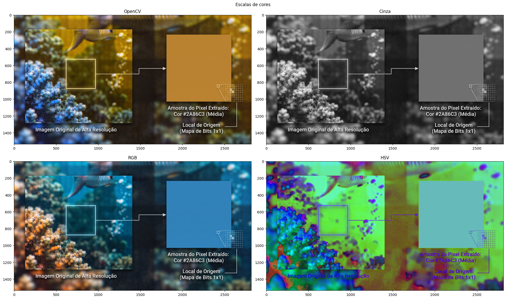

# Fundamentos de Imagens Digitais

---

### 🛠️ Ferramentas Utilizadas

---

<div style="inline-flex">
<a href="https://colab.new" target="_blank"></a>


</div>

---

### 📖 1. O que é uma Imagem Digital?

---

<p>
Toda imagem digital é composta por <strong>pixels</strong> (<em>picture elements</em>), a menor unidade de representação visual computacional. Na prática, <strong>uma imagem é representada na memória como uma matriz (ou tensor) de valores numéricos</strong>, em que cada posição guarda a intensidade luminosa ou de cor daquele ponto.
</p>


Para manipular imagens via código, precisamos compreender quatro conceitos fundamentais: **resolução**, **canais e escalas de cores**, **filtros** e **máscaras**.

#### 📐 Resolução

Consiste nas dimensões espaciais da imagem (**altura × largura**), representando a quantidade total de pixels organizados na matriz.

```text
Maior resolução → Maior quantidade de pixels → Maior nível de detalhes visuais.
```

* **Exemplo prático:** Uma imagem **Full HD** (1920x1080 pixels = 2.07 Mpixels) versus uma **Ultra HD 4K** (3840 x 2160 pixels = 8.29 Mpixels). Qual delas preserva mais detalhes ao darmos zoom?.

---

### 🎨 2. Canais e Escalas de Cores

---

Os **canais** representam a quantidade de camadas que compõem a matriz da imagem. Eles armazenam propriedades como cor, luminosidade e transparência em cada pixel. Em imagens padrão de 8 bits por canal (`uint8`), cada valor varia de **0** (ausência de intensidade) a **255** (intensidade máxima).

A forma como esses canais são combinados define a **escala (ou espaço) de cores**:

=== "RGB / BGR"

    * **Canais:** **R** (*Red*), **G** (*Green*), **B** (*Blue*)
    * **Descrição / Aplicação:** Padrão em telas, monitores e fotografia digital.
    * **Atenção no OpenCV:** Por razões históricas, o OpenCV lê imagens no formato **BGR** (Azul, Verde, Vermelho). Para exibir as cores corretas no `matplotlib`, convertemos de BGR para RGB.

=== "HSV / HSB"

    * **Canais:** **H** (*Hue* / Matiz), **S** (*Saturation* / Saturação), **V/B** (*Value* / *Brightness* / Brilho)
    * **Descrição / Aplicação:** Separa a cor pura (Matiz) da vivacidade (Saturação) e da iluminação (Valor). Essencial em editores de imagem para alterar a **saturação** sem distorcer as cores originais.

=== "Grayscale"

    * **Canais:** **L** (*Luminance* / Intensidade)
    * **Descrição / Aplicação:** Canal único (matriz 2D). Muito utilizado em fotografia P&B, detecção de bordas e pré-processamento leve.

=== "CMYK"

    * **Canais:** **C** (*Cyan*), **M** (*Magenta*), **Y** (*Yellow*), **K** (*Black*)
    * **Descrição / Aplicação:** Modelo subtrativo voltado para impressão gráfica e editorial.

=== "HSL"

    * **Canais:** **H** (*Hue*), **S** (*Saturation*), **L** (*Lightness*)
    * **Descrição / Aplicação:** Desenvolvimento web (CSS) e design de interfaces (UI/UX).

=== "CIE Lab"

    * **Canais:** **L** (*Lightness*), **a** (eixo Verde-Vermelho), **b** (eixo Azul-Amarelo)
    * **Descrição / Aplicação:** Gerenciamento profissional de cor e aproximação da percepção visual humana.

=== "RGBA / HSLA"

    * **Canais:** Canais base + **A** (*Alpha*)
    * **Descrição / Aplicação:** Extensão que adiciona um quarto canal para controle de opacidade/transparência.

=== "YUV / YCbCr"

    * **Canais:** **Y** (*Luma*), **U/Cb** (*Chroma Azul*), **V/Cr** (*Chroma Vermelho*)
    * **Descrição / Aplicação:** Separa a luminosidade da crominância. Usado em transmissão de vídeo e compressão JPEG.



<p style="text-align:center"><strong>Observação:</strong> Maior quantidade de canais → Maior volume de informação por pixel → Maior consumo de memória e processamento.</p>

---

### 🎛️ 3. Filtros, Ajustes e Máscaras

---

Em processamento de imagens, **filtros** são operações matemáticas aplicadas sobre os pixels para modificar a aparência da imagem — seja ajustando cores e iluminação, suavizando ruídos ou destacando contornos.

=== "Ajuste Tonal & Cor"

    Operações ponto a ponto que alteram o brilho, o contraste e a vivacidade das cores:

    * **Brilho e Contraste:** Transformação linear dada por $g(x,y) = \alpha \cdot f(x,y) + \beta$, onde $\alpha$ (*alpha*) controla o **contraste** (amplitude entre claros e escuros) e $\beta$ (*beta*) soma ou subtrai **brilho**.
    * **Matiz / Saturação (HSV Shift):** Altera a roda de cores (Matiz) ou a intensidade/pureza das cores (**Saturação**).
    * **Equalização de Histograma:** Redistribui as intensidades dos pixels para maximizar o contraste global.
    * **Ajuste de Gamma (Correção Gamma):** Mapeia a luminância de forma não linear para corrigir exposição.

=== "Filtros Espaciais (Borramento e Suavização)"

    Modificam o valor de cada pixel calculando uma combinação dos seus pixels vizinhos (convolução):

    * **Borramento por Média (Box Blur):** Substitui o valor do pixel pela média simples dos vizinhos, provocando um borramento uniforme.
    * **Suavização Gaussiana (Gaussian Blur):** Aplica uma matriz de pesos baseada na distribuição gaussiana para suavizar a imagem de forma natural e reduzir ruídos de alta frequência.
    * **Filtro de Mediana (Median Blur):** Substitui o pixel pela mediana da vizinhança. Excelente para remover ruídos do tipo *"sal e pimenta"* preservando contornos.
    * **Filtro Bilateral:** Suaviza regiões internas mantendo as bordas nítidas.
    * **Nitidez (Sharpening / Unsharp Mask):** Realça bordas e detalhes finos aumentando o contraste entre pixels adjacentes.

=== "Detecção de Bordas"

    * **Sobel:** Calcula o gradiente de intensidade nas direções horizontal ($X$) e vertical ($Y$) para destacar transições de brilho.
    * **Canny:** Algoritmo multi-estágio de alta precisão para extração de contornos finos (usa suavização gaussiana, gradiente, supressão de não-máximos e histerese).
    * **Prewitt:** Semelhante ao Sobel, opera com máscaras de convolução direcionais para estimar bordas.

=== "Filtros Morfológicos"

    * **Erosão:** Encolhe regiões claras da imagem, removendo pequenos ruídos brancos e desconectando objetos finos.
    * **Dilatação:** Expande regiões claras, preenchendo pequenos buracos e conectando estruturas próximas.
    * **Abertura / Fechamento:** Combinações de erosão e dilatação usadas para limpar o fundo (abertura) ou fechar falhas internas (fechamento).

=== "Estilização & Efeitos"

    * **Emboss (Relevo):** Cria um efeito tridimensional simulando luz e sombra ao longo das bordas.
    * **Posterizar / Vetorização:** Reduz a paleta de cores da imagem, agrupando gradientes em faixas sólidas.
    * **Vinheta:** Escurece gradualmente as bordas externas para direcionar o foco ao centro da cena.

#### 🎭 Máscaras

O termo **máscara** aparece em dois contextos complementares no processamento de imagens:

1. **Máscara de Região (ROI / Recorte Binário):** Uma imagem em preto e branco (0 e 255) de mesma resolução usada para selecionar quais pixels serão mantidos ou editados (região branca) e quais serão ocultados ou ignorados (região preta).
2. **Máscara de Convolução (Kernel):** Uma pequena matriz (ex.: $3\times3$ ou $5\times5$) que desliza sobre a imagem para calcular borramento, nitidez ou bordas.


---

### 💻 4. Prática: Construindo um Editor de Imagens

---

Nesta prática, vamos construir passo a passo um **Editor de Imagens em Python** capaz de realizar:

- Conversão de escalas de cores (`RGB`, `Escala de Cinza`, `HSV`);
- Mudança de **brilho**, **contraste** e **saturação**;
- **Borramento**, **suavização** e **aplicação de filtros** (Média, Gaussiano, Mediana, Bilateral, Nitidez e Bordas).

> **Dica:** Este material utiliza a biblioteca **OpenCV** como referência. Caso queira consultar os comandos equivalentes na biblioteca **Pillow (PIL)**, acesse o guia comparativo do <a href="https://codoraven.com/category/tutorials/opencv-vs-pillow/" target="_blank">CodoRaven</a>.

---

#### Passo 1: Carregar a imagem e inspecionar sua estrutura

Primeiro, importamos as bibliotecas, abrimos a imagem com o OpenCV e verificamos suas dimensões (`shape`) e quantidade de canais.

```python
import cv2
import numpy as np
import matplotlib.pyplot as plt

# 1. Abertura da imagem (substitua pelo caminho da sua imagem no Colab)
img_bgr = cv2.imread('caminho_da_imagem.jpg')

# Conversão base de BGR (padrão OpenCV) para RGB (padrão de exibição)
img_rgb = cv2.cvtColor(img_bgr, cv2.COLOR_BGR2RGB)

print('Inspeção da Imagem ' + '=' * 25)
print(f'Resolução (Altura x Largura): {img_rgb.shape[0]} x {img_rgb.shape[1]} pixels')
print(f'Quantidade de canais:         {img_rgb.shape[2]}')
print(f'Tipo de dado (dtype):         {img_rgb.dtype}')
print('=' * 44)
```

---

#### Passo 2: Conversão entre escalas de cores

Vamos converter a imagem para diferentes espaços de cores (`RGB`, `Cinza` e `HSV`) e comparar os resultados.

```python
# Conversões de escala de cor
img_cinza = cv2.cvtColor(img_bgr, cv2.COLOR_BGR2GRAY)
img_hsv = cv2.cvtColor(img_bgr, cv2.COLOR_BGR2HSV)

# Visualização lado a lado
fig, ax = plt.subplots(2, 2, figsize=(14, 10))

ax[0][0].set_title('Original no OpenCV (BGR)')
ax[0][0].imshow(img_bgr)
ax[0][0].axis('off')

ax[0][1].set_title('Escala de Cinza (1 Canal)')
ax[0][1].imshow(img_cinza, cmap='gray')
ax[0][1].axis('off')

ax[1][0].set_title('RGB (Cores Reais)')
ax[1][0].imshow(img_rgb)
ax[1][0].axis('off')

ax[1][1].set_title('Espaço HSV (Matiz, Saturação, Brilho)')
ax[1][1].imshow(img_hsv)
ax[1][1].axis('off')

fig.suptitle('Comparação de Escalas de Cores', fontsize=16)
plt.tight_layout()
plt.show()
```

---

#### Passo 3: Ajustes de Brilho, Contraste e Saturação

* **Brilho e Contraste:** Usamos `cv2.convertScaleAbs(img, alpha, beta)`, onde `alpha` multiplica os pixels (contraste: `1.0` mantém original, `> 1.0` aumenta) e `beta` soma um valor constante (brilho: `0` mantém original, valores positivos clareiam e negativos escurecem).
* **Saturação:** Convertemos a imagem para `HSV`, multiplicamos o canal **S** (índice `1`) pelo fator desejado e convertemos de volta para `RGB`.

```python
def ajustar_brilho_contraste(img_rgb, contraste=1.0, brilho=0):
    """
    contraste (alpha): 0.5 (baixo) a 3.0 (alto) | padrão = 1.0
    brilho (beta):    -100 (escuro) a 100 (claro) | padrão = 0
    """
    return cv2.convertScaleAbs(img_rgb, alpha=contraste, beta=brilho)


def ajustar_saturacao(img_rgb, fator_saturacao=1.0):
    """
    fator_saturacao: 0.0 (tons de cinza) a 3.0 (super saturado) | padrão = 1.0
    """
    hsv = cv2.cvtColor(img_rgb, cv2.COLOR_RGB2HSV).astype(np.float32)
    hsv[:, :, 1] = np.clip(hsv[:, :, 1] * fator_saturacao, 0, 255)
    hsv = hsv.astype(np.uint8)
    return cv2.cvtColor(hsv, cv2.COLOR_HSV2RGB)


# Testando os ajustes
img_brilho_contraste = ajustar_brilho_contraste(img_rgb, contraste=1.4, brilho=30)
img_saturada = ajustar_saturacao(img_rgb, fator_saturacao=1.8)
```

---

#### Passo 4: Borramento, Suavização e Aplicação de Filtros

Agora criamos as operações espaciais de borramento, suavização e realce/detecção de bordas:

```python
def aplicar_filtro(img_rgb, tipo='nenhum', intensidade=5):
    # Garante que o tamanho da máscara (kernel) seja ímpar e >= 3
    k = max(3, int(intensidade))
    if k % 2 == 0:
        k += 1

    if tipo == 'borramento_media':
        return cv2.blur(img_rgb, (k, k))

    elif tipo == 'suavizacao_gaussiana':
        return cv2.GaussianBlur(img_rgb, (k, k), 0)

    elif tipo == 'suavizacao_mediana':
        return cv2.medianBlur(img_rgb, k)

    elif tipo == 'suavizacao_bilateral':
        # Suaviza preservando as bordas
        return cv2.bilateralFilter(img_rgb, d=k, sigmaColor=75, sigmaSpace=75)

    elif tipo == 'nitidez':
        kernel_nitidez = np.array([
            [ 0, -1,  0],
            [-1,  5, -1],
            [ 0, -1,  0]
        ])
        return cv2.filter2D(img_rgb, -1, kernel_nitidez)

    elif tipo == 'bordas_canny':
        cinza = cv2.cvtColor(img_rgb, cv2.COLOR_RGB2GRAY)
        return cv2.Canny(cinza, threshold1=80, threshold2=180)

    elif tipo == 'relevo_emboss':
        kernel_emboss = np.array([
            [-2, -1, 0],
            [-1,  1, 1],
            [ 0,  1, 2]
        ])
        return cv2.filter2D(img_rgb, -1, kernel_emboss)

    return img_rgb
```

---

#### Passo 5: Juntando Tudo — O Editor de Imagens Completo

Por fim, integramos todas as funcionalidades em uma única função `editor_de_imagens`. No Google Colab, você pode usar `ipywidgets` (`@interact`) para controlar os parâmetros com barras deslizantes (*sliders*) em tempo real!

```python
from ipywidgets import interact, FloatSlider, IntSlider, Dropdown

def editor_de_imagens(
    escala='RGB',
    brilho=0,
    contraste=1.0,
    saturacao=1.0,
    filtro='nenhum',
    intensidade_filtro=5
):
    # 1. Ajuste de brilho, contraste e saturação na base RGB
    editada = ajustar_brilho_contraste(img_rgb, contraste=contraste, brilho=brilho)
    editada = ajustar_saturacao(editada, fator_saturacao=saturacao)

    # 2. Aplicação de borramento, suavização ou filtro
    editada = aplicar_filtro(editada, tipo=filtro, intensidade=intensidade_filtro)

    # 3. Conversão final de escala de cor (se a saída ainda tiver 3 canais)
    cmap_exibicao = None
    if editada.ndim == 2:
        cmap_exibicao = 'gray'
    elif escala == 'Cinza':
        editada = cv2.cvtColor(editada, cv2.COLOR_RGB2GRAY)
        cmap_exibicao = 'gray'
    elif escala == 'HSV':
        editada = cv2.cvtColor(editada, cv2.COLOR_RGB2HSV)

    # 4. Exibição comparativa: Original vs. Editada
    fig, ax = plt.subplots(1, 2, figsize=(14, 6))

    ax[0].set_title('Imagem Original')
    ax[0].imshow(img_rgb)
    ax[0].axis('off')

    ax[1].set_title(f'Editada ({escala} | Filtro: {filtro})')
    ax[1].imshow(editada, cmap=cmap_exibicao)
    ax[1].axis('off')

    plt.tight_layout()
    plt.show()


# Painel interativo no Google Colab
interact(
    editor_de_imagens,
    escala=Dropdown(options=['RGB', 'Cinza', 'HSV'], value='RGB', description='Escala:'),
    brilho=IntSlider(min=-100, max=100, step=5, value=0, description='Brilho:'),
    contraste=FloatSlider(min=0.5, max=3.0, step=0.1, value=1.0, description='Contraste:'),
    saturacao=FloatSlider(min=0.0, max=3.0, step=0.1, value=1.0, description='Saturação:'),
    filtro=Dropdown(
        options=[
            'nenhum',
            'borramento_media',
            'suavizacao_gaussiana',
            'suavizacao_mediana',
            'suavizacao_bilateral',
            'nitidez',
            'bordas_canny',
            'relevo_emboss'
        ],
        value='nenhum',
        description='Filtro:'
    ),
    intensidade_filtro=IntSlider(min=3, max=31, step=2, value=5, description='Intensidade:')
);
```

---

### 💭 Para ir mais a fundo...

---

#### 📚 Materiais e artigos sugeridos

* <a href="https://docs.opencv.org/4.x/d2/d96/tutorial_py_table_of_contents_imgproc.html" target="_blank">Documentação Oficial do OpenCV — Image Processing in OpenCV (Python)</a>
* <a href="https://codoraven.com/category/tutorials/opencv-vs-pillow/" target="_blank">CodoRaven — Comparativo prático entre OpenCV e Pillow</a>

#### 🤖 Prompts para estudar com LLMs

Copie e cole os prompts abaixo no seu assistente de IA favorito para aprofundar a base teórica:

1. **Representação Matricial, Amostragem e Quantização:**
   > *"Explique como uma imagem digital monocromática e uma colorida são representadas matematicamente na memória (como matrizes/tensores). Aborde os conceitos de amostragem espacial (resolução espacial) e quantização de intensidade (resolução em tons de cinza ou profundidade de bits), detalhando o impacto de cada um na perda ou preservação de detalhes visuais."*

2. **Espaços de Cores na Visão Computacional:**
   > *"Explique o funcionamento dos canais de cor em imagens digitais. Compare o espaço de cores RGB com o HSV (ou HSL) e o CIELAB, explicando em quais cenários de visão computacional ou tratamento de imagem é mais vantajoso converter uma imagem de RGB para HSV ou para tons de cinza (grayscale)."*

3. **Máscaras e Operações Morfológicas:**
   > *"Explique o conceito de máscaras binárias e operações morfológicas básicas em processamento de imagens (Erosão, Dilatação, Abertura e Fechamento). Explique intuitivamente e matematicamente como cada uma dessas quatro operações altera os pixels de uma imagem binarizada e dê exemplos clássicos de uso."*
