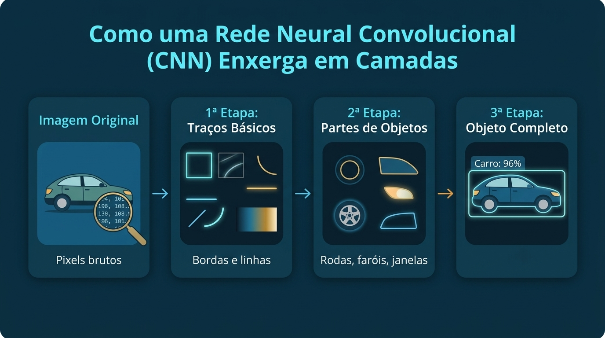
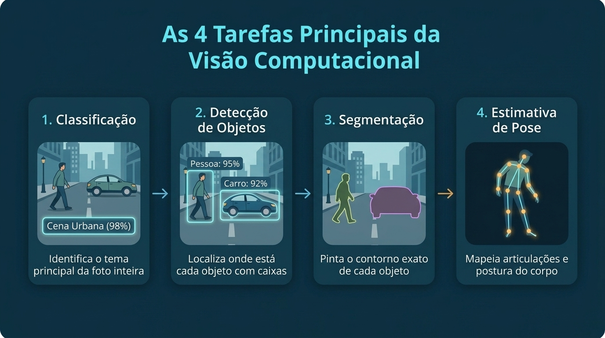
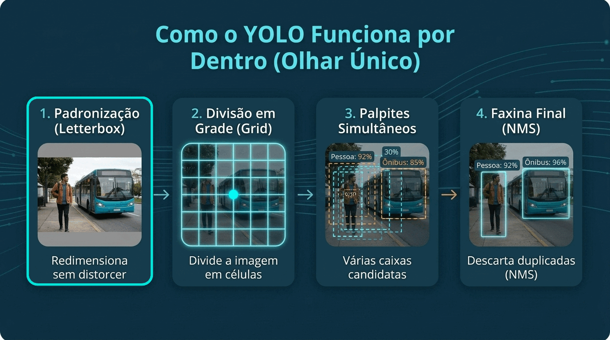

# Modelos de Visão Computacional e YOLO

---

### 🛠️ Ferramentas Utilizadas

---

<div style="inline-flex">
<a href="https://colab.new" target="_blank"></a>


</div>

---

### 🧠 1. Dos Filtros Manuais ao Aprendizado Automático

---

No **Dia 01**, vimos que uma imagem digital é apenas uma tabela cheia de números (os **pixels**) e que podemos aplicar **filtros manuais** para destacar bordas, mudar cores ou borrar uma foto.

Mas pare para pensar: **como ensinar o computador a reconhecer um cachorro, um carro ou uma pessoa?**

Se tentarmos criar regras manuais (como *"se tiver quatro rodas e for vermelho, é um carro"*), nosso programa vai falhar rapidamente. Afinal, um carro pode ser azul, estar de frente (onde só vemos duas rodas), estar no escuro ou parcialmente escondido atrás de uma árvore.

Para resolver isso, usamos **Redes Neurais Artificiais**: em vez de um programador escrever as regras no código, nós mostramos milhares de fotos de exemplo para o computador e **ele mesmo aprende a reconhecer os padrões visuais**.

#### Como o computador "enxerga" uma imagem em camadas?

Na Visão Computacional, o tipo de rede neural mais famoso é a **Rede Neural Convolucional** (ou **CNN**).

Lembra dos filtros do Dia 01 que deslizavam pela imagem procurando bordas? A CNN usa essa exata mesma ideia, mas com um superpoder: **a própria rede descobre sozinha quais filtros deve usar** durante o treinamento, construindo o entendimento da imagem em etapas, do mais simples ao mais complexo:




* **1ª Etapa (Traços básicos):** As primeiras camadas funcionam como detetives procurando apenas linhas retas, curvas simples e mudanças de cor.
* **2ª Etapa (Partes de objetos):** As camadas seguintes juntam esses traços para reconhecer formas menores, como uma roda, uma orelha, uma janela ou um olho.
* **3ª Etapa (O objeto completo):** Por fim, as últimas camadas combinam todas essas pistas (*"tem rodas + tem faróis + tem formato de veículo"*) para concluir com alta certeza: **é um carro!**

#### 🎬 Simulador Animado: Veja uma CNN funcionando por dentro!

Em cada posição da imagem, o **Filtro (Kernel)** $K$ de dimensão $3 \times 3$ multiplica os pixels vizinhos $I$ pelos seus pesos, soma os resultados e aplica a função de ativação $\text{ReLU}$ (que zera valores negativos):

$$z = \sum_{i,j} I(x+i, y+j) \cdot K(i,j) \implies \text{ReLU}(z) = \max(0, z)$$

Observe na animação interativa abaixo como o **Filtro (Kernel)** desliza sobre os pixels da imagem calculando o **Mapa de Características (*Feature Map*)** e ativando as camadas da rede até identificar o objeto. Você pode **pausar**, avançar **passo a passo**, **clicar em qualquer célula** do mapa ou **trocar o filtro**!

<div class="cnn-sim-wrapper" id="cnn-simulator">
  <div class="cnn-sim-header">
    <div class="cnn-sim-title">⚡ Convolução e Camadas da CNN em Tempo Real</div>
    <div class="cnn-sim-controls">
      <select id="cnn-filter-select" class="cnn-sim-select" aria-label="Selecionar filtro da CNN">
        <option value="horizontal">Filtro 1: Bordas Horizontais (Teto/Chassi)</option>
        <option value="vertical">Filtro 2: Bordas Verticais (Para-choques)</option>
        <option value="wheel">Filtro 3: Contorno Circular / Roda</option>
      </select>
      <button type="button" id="cnn-btn-play" class="cnn-sim-btn active">⏸️ Pausar</button>
      <button type="button" id="cnn-btn-step" class="cnn-sim-btn">⏭️ Passo</button>
      <button type="button" id="cnn-btn-speed" class="cnn-sim-btn">🐢 Velocidade: Normal</button>
    </div>
  </div>
  <div class="cnn-sim-stage">
    <div class="cnn-panel">
      <div>
        <div class="cnn-panel-title">1. Imagem de Entrada (Pixels 7×7)</div>
        <div class="cnn-panel-sub">Janela amarela (3×3) deslizando sobre o veículo</div>
      </div>
      <div id="cnn-input-grid" class="cnn-grid-input"></div>
      <div id="cnn-pos-info" class="cnn-math-box">Posição da janela: (linha 0, col 0)</div>
    </div>
    <div class="cnn-panel">
      <div>
        <div class="cnn-panel-title">2. Filtro Aprendido (Kernel 3×3)</div>
        <div class="cnn-panel-sub">Multiplica cada pixel pelo peso e soma tudo</div>
      </div>
      <div id="cnn-kernel-grid" class="cnn-grid-kernel"></div>
      <div id="cnn-calc-info" class="cnn-math-box">Soma (Pixel × Peso) = 0 → ReLU = 0</div>
    </div>
    <div class="cnn-panel">
      <div>
        <div class="cnn-panel-title">3. Mapa de Características (5×5)</div>
        <div class="cnn-panel-sub">Brilho ciano = onde o padrão foi encontrado!</div>
      </div>
      <div id="cnn-output-grid" class="cnn-grid-output"></div>
      <div id="cnn-activation-info" class="cnn-math-box">Clique em uma célula para inspecionar</div>
    </div>
  </div>
  <div class="cnn-layers-pipeline">
    <div class="cnn-layer-step" id="cnn-step-0">
      <div class="cnn-layer-badge">Entrada</div>
      <div class="cnn-layer-name">Matriz de Pixels</div>
      <div class="cnn-layer-desc">Valores numéricos brutos de brilho da imagem (0 a 9).</div>
    </div>
    <div class="cnn-layer-step" id="cnn-step-1">
      <div class="cnn-layer-badge">1ª Camada (Conv + ReLU)</div>
      <div class="cnn-layer-name">Traços e Bordas</div>
      <div class="cnn-layer-desc">O filtro desliza destacando retas e contornos fortes.</div>
    </div>
    <div class="cnn-layer-step" id="cnn-step-2">
      <div class="cnn-layer-badge">2ª Camada (Pooling)</div>
      <div class="cnn-layer-name">Partes do Objeto</div>
      <div class="cnn-layer-desc">Combina bordas em rodas, capô, teto e janelas.</div>
    </div>
    <div class="cnn-layer-step" id="cnn-step-3">
      <div class="cnn-layer-badge">3ª Camada (Saída)</div>
      <div class="cnn-layer-name" id="cnn-pred-label">🚗 Carro: 96%</div>
      <div class="cnn-layer-desc">Decisão final combinando todas as pistas visuais:</div>
      <div class="cnn-prob-bar-bg"><div id="cnn-prob-bar" class="cnn-prob-bar-fill"></div></div>
    </div>
  </div>
</div>

<script>
(function() {
  const inputImage = [
    [0, 0, 0, 0, 0, 0, 0],
    [0, 0, 6, 8, 6, 0, 0],
    [0, 5, 9, 9, 9, 6, 0],
    [4, 9, 9, 9, 9, 9, 5],
    [4, 8, 4, 8, 4, 8, 4],
    [0, 9, 0, 0, 0, 9, 0],
    [0, 0, 0, 0, 0, 0, 0]
  ];
  const kernels = {
    horizontal: {
      weights: [
        [-1, -1, -1],
        [ 2,  2,  2],
        [-1, -1, -1]
      ],
      label: "Bordas Horizontais"
    },
    vertical: {
      weights: [
        [-1,  2, -1],
        [-1,  2, -1],
        [-1,  2, -1]
      ],
      label: "Bordas Verticais"
    },
    wheel: {
      weights: [
        [-1,  1, -1],
        [ 1,  3,  1],
        [-1,  1, -1]
      ],
      label: "Destaque de Roda/Centro"
    }
  };
  let currentFilter = "horizontal";
  let stepIndex = 0;
  let isPlaying = true;
  let speedIndex = 1;
  const speeds = [
    { ms: 950, label: "🐢 Velocidade: Lenta" },
    { ms: 520, label: "⚡ Velocidade: Normal" },
    { ms: 240, label: "🚀 Velocidade: Rápida" }
  ];
  let timer = null;
  const inputGridEl = document.getElementById("cnn-input-grid");
  const kernelGridEl = document.getElementById("cnn-kernel-grid");
  const outputGridEl = document.getElementById("cnn-output-grid");
  const posInfoEl = document.getElementById("cnn-pos-info");
  const calcInfoEl = document.getElementById("cnn-calc-info");
  const actInfoEl = document.getElementById("cnn-activation-info");
  const filterSelectEl = document.getElementById("cnn-filter-select");
  const btnPlayEl = document.getElementById("cnn-btn-play");
  const btnStepEl = document.getElementById("cnn-btn-step");
  const btnSpeedEl = document.getElementById("cnn-btn-speed");
  const probBarEl = document.getElementById("cnn-prob-bar");
  const predLabelEl = document.getElementById("cnn-pred-label");
  if (!inputGridEl || !kernelGridEl || !outputGridEl) return;
  function computeConv(outR, outC, weights) {
    let rawSum = 0;
    for (let kr = 0; kr < 3; kr++) {
      for (let kc = 0; kc < 3; kc++) {
        rawSum += inputImage[outR + kr][outC + kc] * weights[kr][kc];
      }
    }
    const relu = Math.max(0, rawSum);
    return { rawSum, relu };
  }
  function renderGrids() {
    const outR = Math.floor(stepIndex / 5);
    const outC = stepIndex % 5;
    const weights = kernels[currentFilter].weights;
    inputGridEl.innerHTML = "";
    for (let r = 0; r < 7; r++) {
      for (let c = 0; c < 7; c++) {
        const val = inputImage[r][c];
        const cell = document.createElement("div");
        const inWin = (r >= outR && r < outR + 3 && c >= outC && c < outC + 3);
        cell.className = "cnn-cell" + (inWin ? " in-window" : "");
        const intensity = Math.round((val / 9) * 210);
        cell.style.backgroundColor = val > 0 ? `rgb(${Math.round(intensity * 0.25)}, ${Math.round(intensity * 0.78)}, ${intensity})` : "#0b192c";
        cell.style.color = val >= 6 ? "#020617" : "#cbd5e1";
        cell.textContent = val;
        inputGridEl.appendChild(cell);
      }
    }
    kernelGridEl.innerHTML = "";
    for (let kr = 0; kr < 3; kr++) {
      for (let kc = 0; kc < 3; kc++) {
        const w = weights[kr][kc];
        const p = inputImage[outR + kr][outC + kc];
        const cell = document.createElement("div");
        cell.className = "cnn-cell";
        cell.style.backgroundColor = w > 0 ? "rgba(6, 228, 217, 0.28)" : "rgba(244, 63, 94, 0.22)";
        cell.style.color = w > 0 ? "#06e4d9" : "#fda4af";
        cell.textContent = `${p}×(${w})`;
        kernelGridEl.appendChild(cell);
      }
    }
    outputGridEl.innerHTML = "";
    let maxVal = 1;
    const allValues = [];
    for (let r = 0; r < 5; r++) {
      for (let c = 0; c < 5; c++) {
        const res = computeConv(r, c, weights);
        allValues.push(res);
        if (res.relu > maxVal) maxVal = res.relu;
      }
    }
    for (let idx = 0; idx < 25; idx++) {
      const r = Math.floor(idx / 5);
      const c = idx % 5;
      const cell = document.createElement("div");
      const isCurrent = idx === stepIndex;
      const isComputed = idx <= stepIndex;
      cell.className = "cnn-cell" + (isCurrent ? " active-out" : "");
      cell.style.cursor = "pointer";
      if (isComputed) {
        const val = allValues[idx].relu;
        const ratio = val / maxVal;
        const g = Math.round(40 + ratio * 188);
        const b = Math.round(65 + ratio * 152);
        cell.style.backgroundColor = val > 0 ? `rgb(6, ${g}, ${b})` : "#0f172a";
        cell.style.color = ratio > 0.55 ? "#020617" : "#e2e8f0";
        cell.textContent = val;
      } else {
        cell.style.backgroundColor = "#091326";
        cell.style.color = "#475569";
        cell.textContent = "·";
      }
      cell.addEventListener("click", function() {
        pauseSim();
        stepIndex = idx;
        renderGrids();
      });
      outputGridEl.appendChild(cell);
    }
    const currentRes = allValues[stepIndex];
    posInfoEl.textContent = `Janela 3×3 na linha ${outR + 1}, coluna ${outC + 1} (Passo ${stepIndex + 1}/25)`;
    calcInfoEl.textContent = `Soma = ${currentRes.rawSum} ──► ReLU max(0, ${currentRes.rawSum}) = ${currentRes.relu}`;
    actInfoEl.textContent = currentRes.relu >= 12
      ? `🔥 Forte ativação (${currentRes.relu}): padrão detectado aqui!`
      : (currentRes.relu > 0 ? `✨ Ativação moderada (${currentRes.relu})` : `⚪ Sem ativação (0): fundo ou padrão ausente`);
    const progress = Math.round(((stepIndex + 1) / 25) * 96);
    probBarEl.style.width = `${progress}%`;
    predLabelEl.textContent = `🚗 Carro: ${progress}%`;
    const activeStage = stepIndex < 6 ? 0 : (stepIndex < 14 ? 1 : (stepIndex < 21 ? 2 : 3));
    for (let s = 0; s < 4; s++) {
      const el = document.getElementById(`cnn-step-${s}`);
      if (el) {
        el.classList.toggle("highlight", s === activeStage);
      }
    }
  }
  function nextStep() {
    stepIndex = (stepIndex + 1) % 25;
    renderGrids();
  }
  function startSim() {
    if (timer) clearInterval(timer);
    isPlaying = true;
    btnPlayEl.textContent = "⏸️ Pausar";
    btnPlayEl.classList.add("active");
    timer = setInterval(nextStep, speeds[speedIndex].ms);
  }
  function pauseSim() {
    if (timer) clearInterval(timer);
    timer = null;
    isPlaying = false;
    btnPlayEl.textContent = "▶️ Continuar";
    btnPlayEl.classList.remove("active");
  }
  btnPlayEl.addEventListener("click", function() {
    if (isPlaying) pauseSim();
    else startSim();
  });
  btnStepEl.addEventListener("click", function() {
    pauseSim();
    nextStep();
  });
  btnSpeedEl.addEventListener("click", function() {
    speedIndex = (speedIndex + 1) % speeds.length;
    btnSpeedEl.textContent = speeds[speedIndex].label;
    if (isPlaying) startSim();
  });
  filterSelectEl.addEventListener("change", function(e) {
    currentFilter = e.target.value;
    stepIndex = 0;
    renderGrids();
  });
  renderGrids();
  startSim();
})();
</script>

---

### 🎯 2. O que a Visão Computacional consegue fazer?

---

Dependendo do problema que queremos resolver no mundo real, podemos pedir para o modelo responder a diferentes perguntas sobre uma imagem. Veja as **4 tarefas principais**:



=== "1. Classificação"

    * **A pergunta:** *"Qual é o tema principal desta foto?"*
    * **Como funciona:** O modelo olha para a imagem inteira e devolve apenas uma etiqueta (classe) geral.
    * **Exemplo:** Dizer se uma foto é de um `gato` ou de um `cachorro`.
    * **Limitação:** Se houver três gatos e duas pessoas na mesma foto, a classificação simples não diz **onde** cada um está nem **quantos** são.

=== "2. Detecção de Objetos"

    * **A pergunta:** *"Quais objetos estão na foto e **onde** está cada um?"*
    * **Como funciona:** O modelo desenha um retângulo — chamado de **Caixa Delimitadora (*Bounding Box*)** — ao redor de cada objeto encontrado, informando o nome do objeto e a porcentagem de certeza.
    * **Exemplo:** Contar quantas pessoas, carros e semáforos aparecem em uma câmera de trânsito.

=== "3. Segmentação"

    * **A pergunta:** *"Qual é o contorno exato de cada objeto?"*
    * **Como funciona:** Em vez de apenas desenhar um retângulo ao redor, o modelo pinta exatamente os pixels que pertencem a cada objeto (como se recortasse o objeto com uma tesoura mágica).
    * **Exemplo:** Separar a área exata da pista em carros autônomos ou medir o tamanho exato de uma folha na agricultura.

=== "4. Estimativa de Pose"

    * **A pergunta:** *"Em que posição está o corpo desta pessoa?"*
    * **Como funciona:** O modelo localiza pontos estratégicos do corpo (ombros, cotovelos, mãos, joelhos) e liga esses pontos formando um "esqueleto".
    * **Exemplo:** Analisar se um trabalhador está com a postura correta, acompanhar exercícios físicos ou detectar se um idoso sofreu uma queda.


---

### ⚡ 3. O que é o YOLO e por que ele revolucionou a área?

---

Antigamente, detectar objetos em uma foto era um processo muito lento. Os algoritmos funcionavam como alguém procurando um objeto no escuro com uma lanterna pequena: eles recortavam milhares de pedacinhos da imagem e analisavam um por um (*"Tem um carro neste canto? Não. E um pouco mais para o lado? Também não..."*).

Por causa disso, analisar uma única foto demorava vários segundos — o que tornava impossível usar esses modelos em **vídeos ao vivo** ou câmeras de segurança.

Em 2016, surgiu o **YOLO**, sigla para ***You Only Look Once*** (em português, **"Você Só Olha Uma Vez"**).

```text
Abordagem Antiga (Duas Etapas - Lenta):
Foto ──► Recorta milhares de pedaços ──► Analisa um por um ──► Resultado (Demorado 🐢)

Abordagem do YOLO (Olhar Único - Tempo Real):
Foto ──► Olha a imagem inteira de uma só vez ──► Resultado Instantâneo (Tempo Real ⚡)
```

O grande diferencial do YOLO é que ele analisa a **imagem inteira de uma única vez**, conseguindo processar dezenas de quadros por segundo mesmo em computadores comuns ou celulares.

---

#### 🔍 Como o YOLO funciona por dentro? (Passo a Passo)

Quando entregamos uma imagem para o YOLO, ele executa **4 passos simples e organizados** para encontrar todos os objetos:



##### Passo 1: Padronização da Imagem (*Letterbox*)
A rede neural do YOLO espera receber imagens sempre de mesmo tamanho (por exemplo, um quadrado de $640 \times 640\text{ pixels}$). Mas se você enviar uma foto retangular de celular e simplesmente "espremê-la" para virar um quadrado, uma pessoa parecerá achatada ou esticada, confundindo o modelo.
Por isso, o YOLO usa uma técnica chamada **Letterbox**: ele diminui a foto mantendo o formato original dos objetos e preenche o espaço que sobrar nas bordas com faixas cinzas (igual às faixas pretas de um filme na TV).

##### Passo 2: Divisão em Grade (*Grid*)
Imagine que o YOLO desenha uma **grade invisível** ($S \times S$) sobre a imagem, dividindo a foto em vários quadradinhos (como um tabuleiro de xadrez).

```text
+-------+-------+-------+
|       |       |       |   • A imagem é dividida em células (quadradinhos).
+-------+-------+-------+   • O quadradinho onde cai o CENTRO do objeto (●)
|       |   ●   |       |     fica responsável por dizer:
+-------+-------+-------+     "Aqui tem uma pessoa, e a caixa dela tem este tamanho!"
|       |       |       |
+-------+-------+-------+
```

> **Detalhe esperto:** Para não deixar passar nada, o YOLO cria **3 grades de tamanhos diferentes** ao mesmo tempo: uma grade bem miúda para achar **objetos pequenos** (como um celular ou pássaro longe), uma média para **objetos médios** (uma pessoa) e uma grade grande para **objetos gigantes** (um ônibus inteiro na frente da câmera).

##### Passo 3: Palpites Simultâneos em Cada Quadradinho
Todos os quadradinhos da grade trabalham juntos e ao mesmo tempo. Cada quadradinho onde cai o centro de um objeto entrega um "pacote de informações" contendo:

1. **Onde está a caixa (*Bounding Box*):** As coordenadas $(x_1, y_1)$ e $(x_2, y_2)$ de onde a caixa começa e onde termina (ou centro $(x, y)$ com largura $w$ e altura $h$).
2. **O que é o objeto (*Classe*):** Se é uma `pessoa`, um `carro`, um `cachorro`, uma `mochila`, etc.
3. **Qual a certeza (*Confiança*):** Uma nota $c \in [0, 1]$ (de $0\%$ a $100\%$) indicando o quão seguro o modelo está daquele palpite.

##### Passo 4: A Faxina Final (Filtro de Confiança + NMS)
Como a grade tem milhares de quadradinhos dando palpites ao mesmo tempo, dois problemas acontecem: muitos quadradinhos dão palpites fracos onde não há nada, e quadradinhos vizinhos acabam desenhando **várias caixas repetidas sobre a mesma pessoa**.

Para entregar um resultado limpo, o YOLO faz uma faxina automática em duas etapas:

1. **Filtro de Confiança (*Confidence*):** Definimos uma nota de corte (por exemplo, $40\%$ ou $0{,}40$). Qualquer palpite com certeza menor que $40\%$ é descartado na hora.
2. **Eliminação de Caixas Repetidas (*NMS — Non-Maximum Suppression*):** Quando duas ou mais caixas estão sobrepostas em cima do mesmo objeto (medido pela métrica $\text{IoU} = \frac{\text{Área de Interseção}}{\text{Área de União}}$), o YOLO compara a nota de certeza delas, **mantém apenas a melhor caixa** e apaga todas as outras repetidas!

```text
Antes da limpeza (NMS):            Depois da limpeza (NMS):
┌─────────────┐                    ┌─────────────┐
│ ┌───────────┼─┐                  │             │
│ │ Pessoa 92%│ │  ──────────────► │ Pessoa 92%  │
└─┼───────────┘ │                  │             │
  └─────────────┘                  └─────────────┘
(Caixas repetidas: 92%, 85%, 78%)  (Fica apenas a melhor!)
```

---

#### 📦 O que o YOLO já sabe de fábrica? (Base COCO e Tamanhos)

Você não precisa treinar o YOLO do zero para começar a usar! Os modelos oficiais (como o **YOLOv8** e o **YOLO11**, da biblioteca `ultralytics`) já vêm pré-treinados em um famoso banco de imagens chamado **COCO**, o que significa que eles já reconhecem **80 tipos de objetos do dia a dia** instantaneamente:

* **Pessoas e Acessórios:** `person` (pessoa), `backpack` (mochila), `umbrella` (guarda-chuva), `handbag` (bolsa), `tie` (gravata)...
* **Trânsito e Rua:** `car` (carro), `bus` (ônibus), `motorcycle` (moto), `bicycle` (bicicleta), `truck` (caminhão), `traffic light` (semáforo)...
* **Animais:** `dog` (cachorro), `cat` (gato), `bird` (pássaro), `horse` (cavalo)...
* **Objetos Domésticos e Eletrônicos:** `cell phone` (celular), `laptop` (notebook), `bottle` (garrafa), `cup` (copo), `chair` (cadeira), `couch` (sofá), `tv` (televisão)...

Além disso, o YOLO é disponibilizado em **5 tamanhos diferentes** (indicados pela última letra do nome do arquivo, como `yolov8n.pt`):

| Sufixo | Tamanho | Velocidade | Precisão | Quando usar? |
| :--- | :--- | :--- | :--- | :--- |
| **`n`** (*Nano*) | Super leve | ⚡⚡⚡⚡⚡ | ⭐⭐⭐ | Ideal para aulas, notebooks comuns, celulares e testes rápidos (`yolov8n.pt`). |
| **`s`** (*Small*) | Pequeno | ⚡⚡⚡⚡ | ⭐⭐⭐⭐ | Bom equilíbrio entre velocidade e precisão em vídeos ao vivo. |
| **`m`** (*Medium*) | Médio | ⚡⚡⚡ | ⭐⭐⭐⭐ | Uso geral quando se tem uma placa de vídeo (GPU) básica. |
| **`l`** (*Large*) | Grande | ⚡⚡ | ⭐⭐⭐⭐⭐ | Cenários com objetos difíceis ou muito pequenos. |
| **`x`** (*Extra Large*) | Pesado | ⚡ | ⭐⭐⭐⭐⭐ | Quando a precisão máxima é mais importante que a velocidade. |

---

### 💻 4. Prática: Identificando Objetos em Imagens e Vídeos com YOLO

---

Chegou a hora de colocar a mão na massa! No nosso notebook prático no **Google Colab**, vamos utilizar a biblioteca **Ultralytics YOLO** junto com o **OpenCV** para desenvolver as seguintes etapas:

1. **Configuração e Carregamento do Modelo:** instalação do pacote `ultralytics` e inspeção das $80$ classes pré-treinadas do modelo `yolov8n.pt`.
2. **Detecção de Objetos em Imagens:** inferência com filtro de confiança (`conf=0.40`), plotagem das caixas delimitadoras (*Bounding Boxes*) e leitura das coordenadas $(x_1, y_1, x_2, y_2)$.
3. **Extração Estruturada (Ponte para o Dia 03):** criação das funções `detectar_objetos()` e `contar_objetos()` que organizam as saídas do modelo em listas de dicionários prontas para tomada de decisão.
4. **Segmentação de Instâncias e Estimativa de Pose:** execução comparativa dos modelos `yolov8n-seg.pt` (máscaras de contorno exato) e `yolov8n-pose.pt` (articulações do esqueleto humano).
5. **Processamento de Vídeos (*Frame a Frame*):** leitura de vídeos com `cv2.VideoCapture`, detecção quadro a quadro e exportação do vídeo anotado com `cv2.VideoWriter`.

<p style="text-align: center; margin-top: 24px;">
<a style="font-size:2vh; background-color: #06e4d9 !important; padding: 10px 18px; border-radius: 6px; color: #000; font-weight: bold; text-decoration: none;" href="https://colab.new" target="_blank">Clique aqui para abrir o projeto no Colab</a>
</p>

---

### 💭 Para ir mais a fundo...

---

#### 📚 Ferramentas visuais e links úteis

* <a href="https://poloclub.github.io/cnn-explainer/" target="_blank">CNN Explainer — Veja uma Rede Neural Convolucional funcionando por dentro de forma visual e interativa no navegador</a>
* <a href="https://playground.tensorflow.org/" target="_blank">TensorFlow Playground — Simulador interativo para brincar com redes neurais sem precisar programar</a>
* <a href="https://docs.ultralytics.com/pt/" target="_blank">Documentação Oficial da Ultralytics YOLO (em Português)</a>

#### 🤖 Prompts para estudar com Inteligência Artificial

Quer tirar dúvidas ou explorar novos projetos? Copie e cole os prompts abaixo no ChatGPT, Claude ou Gemini:

1. **Entendendo redes neurais e filtros com analogias do dia a dia:**
   > *"Estou começando a aprender Visão Computacional. Explique, usando analogias simples do cotidiano e sem fórmulas matemáticas, qual é a diferença entre usar um filtro manual de imagem (como no Photoshop ou OpenCV) e usar uma Rede Neural Convolucional (CNN) para reconhecer objetos."*

2. **Revisando como o YOLO pensa:**
   > *"Explique passo a passo para um iniciante como o modelo YOLO consegue detectar vários objetos em uma imagem de uma só vez. Use exemplos simples para explicar o que é a divisão em grade (grid), o filtro de confiança (confidence) e por que ele precisa remover caixas repetidas (NMS) no final."*

3. **Treinando o YOLO para reconhecer novos objetos (Personalização):**
   > *"Já sei usar o YOLO pré-treinado em Python para detectar pessoas e carros. Agora quero ensinar o YOLO a reconhecer um objeto específico do meu projeto (por exemplo, capacetes de segurança ou placas de trânsito). Explique de forma simples e passo a passo como funciona esse processo: quantas fotos preciso tirar, como marcar os objetos nas fotos usando ferramentas gratuitas e como rodar o treinamento no Google Colab."*
