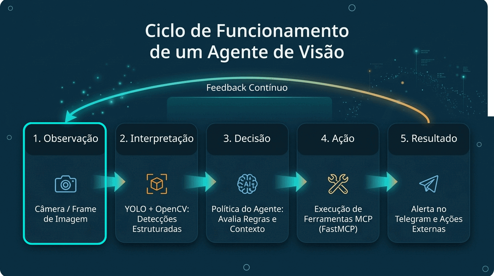
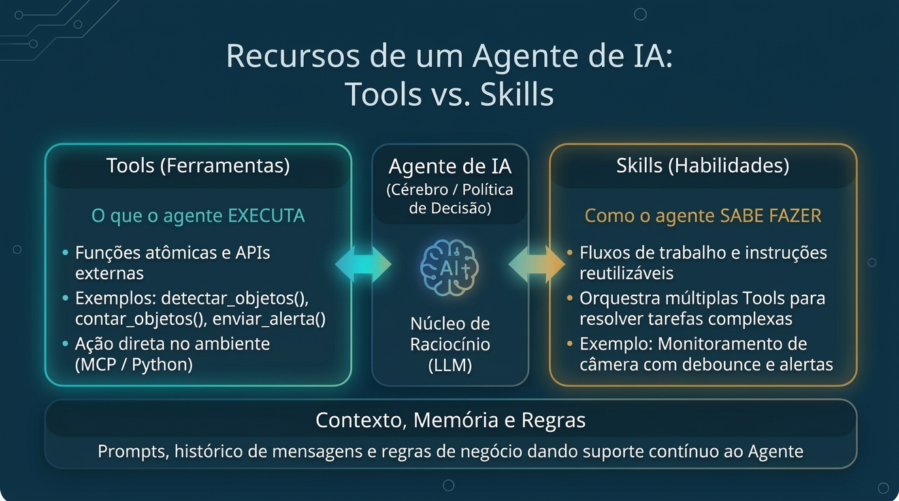
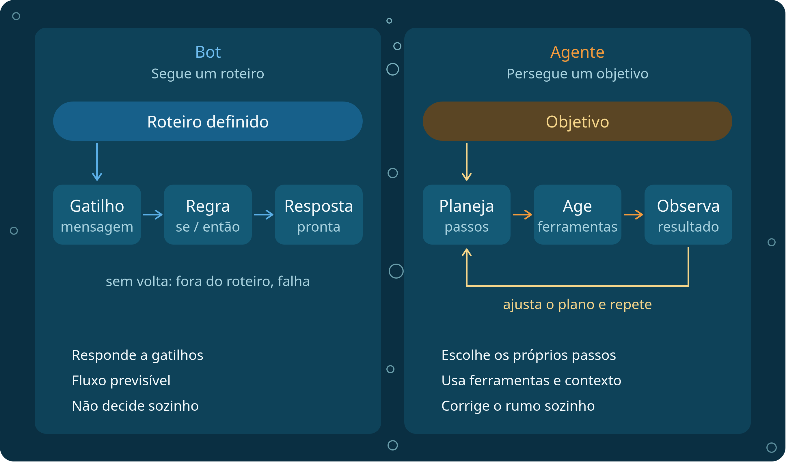
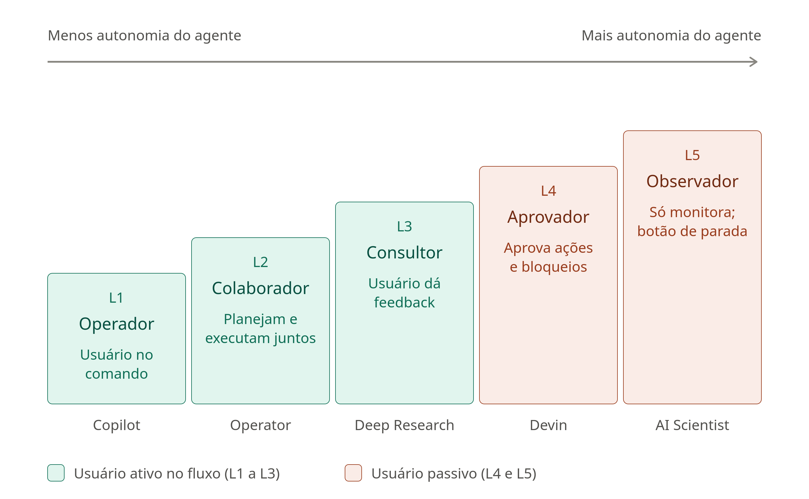
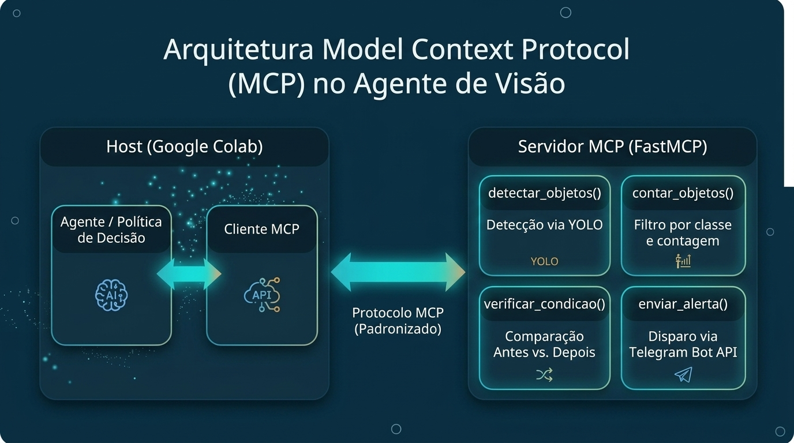
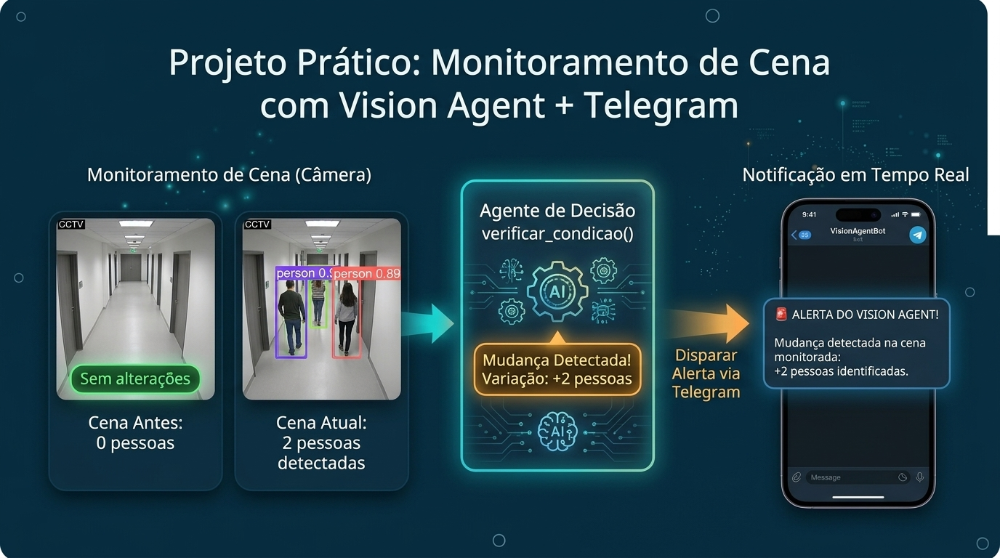

# Agentes + Visão Computacional

---

### 🛠️ Ferramentas Utilizadas

---

---

### 🤖 1. O que é um Agente de IA?

---

Nos **Dias 01 e 02**, aprendemos a manipular pixels e a utilizar modelos como o **YOLO** para detectar objetos em imagens e vídeos. Porém, um detector convencional apenas retorna dados brutos (caixas, classes e probabilidades). Como transformar essas detecções em **tomada de decisão e ação no mundo real**?

É aqui que entra o conceito de **Agente de IA**: um sistema que **observa** um ambiente, **processa** informações e **escolhe ações** para alcançar um objetivo específico.

* **Combinação de técnicas:** Um agente pode combinar modelos de aprendizado de máquina (como redes neurais), regras de negócio e funções Python. **Nem todo agente precisa usar um Modelo de Linguagem (LLM)** — agentes baseados em regras ou políticas determinísticas são rápidos, previsíveis e amplamente usados na indústria.
* **Agente de Visão (*Vision Agent*):** Utiliza imagens ou vídeos como **observações** do ambiente. Enquanto um detector comum apenas lista os objetos identificados, o agente de visão usa essas detecções para escolher verificações adicionais, acionar ferramentas externas e decidir o próximo passo.

#### Recursos Disponíveis em um Agente: *Tools*, *Skills* e Contexto

Para que um agente consiga ir além de apenas processar dados e passe a resolver problemas reais, ele se apoia em três pilares principais de recursos:

=== "Tools (Ferramentas — O que o agente EXECUTA)"

    * **Papel:** São funções atômicas, APIs externas ou integrações que permitem ao agente interagir diretamente com o mundo externo (ler sensores, rodar um modelo, consultar um banco de dados ou enviar uma mensagem).
    * **No nosso projeto:** Funções como `detectar_objetos()`, `contar_objetos()`, `verificar_condicao()` e `enviar_alerta()` expostas via Python/MCP.

=== "Skills (Habilidades — Como o agente SABE FAZER)"

    * **Papel:** São fluxos de trabalho estruturados, instruções passo a passo e boas práticas reutilizáveis que ensinam o agente a combinar múltiplas *Tools* para cumprir uma tarefa complexa.
    * **No nosso projeto:** A rotina completa de monitoramento de câmera — que coordena a comparação antes/depois, aplica confirmação temporal (*debounce*) e decide quando notificar a equipe.

=== "Contexto, Memória e Regras (Base de Suporte)"

    * **Papel:** Reúne os *prompts* do sistema, o histórico de observações anteriores (como a contagem de objetos no quadro passado) e as regras de negócio que guiam as decisões do agente.

---

### ⚖️ 2. Bot vs. Agente e Níveis de Autonomia

---

#### Bot e Agente: qual é a diferença?

Um **bot** automatiza interações ou tarefas repetitivas seguindo um roteiro fixo (*gatilho → regra → resposta*). Já um **agente** persegue um objetivo: ele planeja passos, usa ferramentas, observa o resultado e ajusta a rota quando necessário.

> **Importante:** Os conceitos não são excludentes! Um **bot** (como um bot do Telegram) pode fazer parte de um sistema **agente**, atuando como o canal de comunicação ou ferramenta de notificação do agente.

#### Níveis de Autonomia de Agentes de IA

Dependendo de quanto controle o humano mantém sobre o sistema e de como o agente planeja suas ações, classificamos os agentes em **5 níveis de autonomia** — divididos entre aqueles em que o **usuário é ativo no fluxo (L1 a L3)** e aqueles em que o **usuário é passivo (L4 e L5)**, apenas aprovando bloqueios ou monitorando o sistema:

 Artigo original: <a href="https://arxiv.org/html/2506.12469v1" target="_blank">Levels of Autonomy for AI Agents Working Paper.</a>

> **No nosso projeto prático:** Construiremos um agente que opera com **política determinística em código** (onde definimos os critérios de decisão e o agente executa o monitoramento de forma autônoma) e veremos como ele pode ser expandido com um **LLM** para planejar passos de forma mais flexível.

---

### 🔌 3. Model Context Protocol (MCP)

---

Quando construímos agentes que precisam acionar diversas funções (consultar bancos de dados, verificar sensores, analisar imagens ou enviar mensagens), integrar cada ferramenta manualmente pode se tornar confuso.

O **Model Context Protocol (MCP)** é um protocolo aberto que padroniza a forma como aplicações de IA descobrem e utilizam ferramentas (*tools*) e recursos disponibilizados por servidores compatíveis.

#### Componentes da Arquitetura MCP:

=== "Host (Anfitrião)"

    * **Papel:** É a aplicação principal que integra o modelo ou a política do agente e coordena toda a interação (por exemplo, o nosso notebook no Google Colab ou uma aplicação em produção).

=== "Cliente MCP"

    * **Papel:** Componente dentro do Host que mantém a conexão com o servidor MCP, consulta quais ferramentas estão disponíveis e solicita a execução de operações.

=== "Servidor MCP"

    * **Papel:** Expõe ferramentas padronizadas (como funções Python decoradas com `@mcp.tool()`) para que o cliente possa chamá-las de forma segura e estruturada.

> **Atenção:** O MCP **não é um modelo de IA** e não escolhe sozinho quais ferramentas usar. A decisão sempre cabe ao **agente** (seja via regras em código ou via LLM). No Google Colab, cliente e servidor podem ser testados na mesma sessão utilizando o `FastMCP`.

---

### 💻 4. Prática: Vision Agent para Detectar Mudanças entre Imagens

---

Nesta prática final, vamos integrar tudo o que construímos no minicurso para criar no **Google Colab** um **Vision Agent completo**, capaz de inspecionar imagens com **YOLO + OpenCV**, tomar decisões com base nas detecções, acionar ferramentas via **MCP** e enviar alertas automáticos no **Telegram**!

#### Ferramentas do Agente (`FastMCP`)

* `detectar_objetos(caminho_imagem, confianca)`: executa o YOLO e retorna classes, confiança e coordenadas $(x_1, y_1, x_2, y_2)$.
* `contar_objetos(deteccoes, classe)`: contabiliza as detecções de uma classe específica na cena.
* `verificar_condicao(observacao)`: calcula a variação na contagem ($\Delta C = C_{\text{depois}} - C_{\text{antes}}$) e avalia se houve mudança relevante na classe monitorada.
* `enviar_alerta(mensagem, token_bot, chat_id, caminho_foto)`: envia mensagem de texto e/ou foto anotada pelo YOLO via **Telegram Bot API**.

#### Como o agente escolhe o que investigar?

=== "Versão Básica (Regras Determinísticas)"

    A versão padrão do nosso projeto utiliza **regras determinísticas em Python**:

    1. O agente observa a cena comparando duas imagens (*antes* e *depois*) com `detectar_objetos()` e `contar_objetos()`.
    2. Se houver presença ou variação na contagem da classe monitorada ($\Delta C \neq 0$, ex.: `person`), a política do agente aciona `verificar_condicao(observacao)`.
    3. Caso a verificação confirme uma mudança relevante ($C_{\text{depois}} > 0$), a regra de ação dispara `enviar_alerta()` para notificar o usuário no Telegram (com texto e imagem anotada).

=== "Versão com LLM (Planejador Autônomo)"

    Um **Modelo de Linguagem (LLM)** pode substituir ou complementar esse planejador determinístico:

    * Em vez de `if/else` fixos, o LLM lê a lista de ferramentas do Servidor MCP (a partir das *docstrings* e tipos do Python) e escolhe quais chamar com base no objetivo em linguagem natural.
    * Como essa opção exige acesso a um provedor de modelo e uma chave de API (`API Key`), ela é opcional e não é necessária para executar a versão básica do minicurso.

> **💡 Dica para o mundo real (Evitando Flood de Alertas em Vídeos):**
> Se você conectar esse agente a uma câmera ao vivo (usando o loop de vídeo do **Dia 02**), uma pessoa caminhando na cena aparecerá em $30\text{ quadros/s}$ — o que dispararia $30$ mensagens seguidas no Telegram! Em sistemas reais, adicionamos 
duas regras simples na política do agente:
>
> 1. **Confirmação Temporal (*Debounce*):** Só confirmar a mudança se a nova contagem se mantiver por pelo menos $N$ quadros consecutivos (evita falsos positivos de um único frame borrado).
> 2. **Tempo de Resfriamento (*Cooldown*):** Guardar o horário do último envio (`time.time()`) e aguardar um intervalo mínimo ($\Delta t \ge 60\text{ s}$) antes de enviar um novo alerta da mesma classe.

<a style="font-size:2vh; background-color: #06e4d9 !important; padding: 10px 18px; border-radius: 6px; color: #000; font-weight: bold; text-decoration: none;" href="https://www.kaggle.com/code/marcostavar3s/pratica-dia03" target="_blank">Clique aqui para abrir o projeto no Kaggle</a>

---

### 🧠 5. Reflexão: O Experimento da Sala Chinesa — A IA tem consciência?

---

Ao longo deste minicurso, evoluímos de simples matrizes de pixels (**Dia 01**) para redes neurais capazes de reconhecer dezenas de objetos em tempo real (**Dia 02**) e, finalmente, construímos um **Agente de Visão** que observa uma cena, interpreta mudanças, toma decisões e envia alertas (**Dia 03**). Diante de sistemas tão autônomos — especialmente quando combinados a grandes Modelos de Linguagem (LLMs) — surge uma pergunta inevitável:

> **Quando uma IA "enxerga" uma pessoa na imagem ou "decide" agir, ela realmente compreende o que está fazendo? A IA possui consciência?**

Para responder a essa questão, o filósofo **John Searle** propôs em 1980 um dos exercícios mentais mais famosos da ciência da computação e da filosofia da mente: **O Argumento da Sala Chinesa** (*Chinese Room*).

#### 📦 Como funciona o exercício mental?

Imagine a seguinte situação passo a passo:

1. Uma pessoa que **não sabe absolutamente nada de chinês** (fala apenas português) está trancada sozinha dentro de uma sala fechada.
2. Dentro da sala, existem caixas cheias de ideogramas chineses e um **manual gigantesco de regras em português**. O manual não traduz nenhuma palavra; ele apenas dá instruções visuais sobre os formatos dos símbolos, como:
   > *"Se você receber uma folha com o símbolo `你好`, procure na caixa 3 e devolva uma folha com os símbolos `您好`."*
3. Do lado de fora da sala, um **falante nativo de chinês** passa perguntas escritas em chinês por baixo da porta (*Entrada / Input*).
4. A pessoa trancada olha o desenho dos símbolos recebidos, segue rigorosamente as instruções do manual (*Processamento*) e devolve a resposta em chinês por baixo da porta (*Saída / Output*).

Para quem está do lado de fora, a conversa flui tão bem que parece haver alguém fluente em chinês dentro da sala. Porém, **John Searle** faz a pergunta decisiva: **a pessoa lá dentro (ou a sala como um todo) aprendeu ou entende chinês?**

Segundo a resposta defendida por **John Searle**, a resposta é um categórico **NÃO**. Para Searle, o operador dentro da sala apenas aprendeu a **manipular símbolos formais** seguindo um livro de regras, sem compreender o significado real de uma única palavra que recebeu ou devolveu.

#### ⚖️ Sintaxe vs. Semântica (IA Fraca vs. IA Forte)

Com o experimento da Sala Chinesa, John Searle sustenta que executar um programa de computador — por mais sofisticado que seja — nunca gera compreensão ou consciência por si só, dividindo a discussão em dois conceitos:

=== "Sintaxe (Manipulação de Símbolos — IA Fraca)"

    * **O que é:** A capacidade de processar entradas e gerar saídas corretas seguindo regras matemáticas, lógicas ou estatísticas.
    * **Na prática (O que existe hoje):** É onde estão todos os modelos atuais (OpenCV, YOLO, LLMs e Agentes). O sistema simula um comportamento inteligente com extrema eficiência, mas apenas manipula padrões matemáticos sem saber o que eles significam no mundo real.

=== "Semântica (Significado e Consciência — IA Forte)"

    * **O que é:** Ter compreensão real do significado das coisas, intencionalidade e experiência subjetiva (consciência de existir, sentir e compreender conceitos).
    * **Na visão de Searle:** A mera execução de regras sintáticas **não produz semântica**. A máquina não "sabe" o que é um ser humano, um perigo ou um sentimento; ela apenas calcula probabilidades.

#### 🔍 O que isso significa para a Visão Computacional e os Agentes?

* **No YOLO:** Quando o modelo detecta `person (94%)`, ele não sabe o que é uma pessoa nem tem consciência de estar olhando para uma vida humana. Para a rede neural, a foto é apenas uma grade de números ($0$ a $255$) que, multiplicada por milhões de pesos matemáticos, ativou um rótulo no final da conta.
* **Nos Agentes e LLMs:** Quando um agente escolhe chamar a ferramenta `enviar_alerta()`, ele opera exatamente como o habitante da **Sala Chinesa de Searle**: cruza entradas com regras ou probabilidades estatísticas de forma brilhante, mas **não tem consciência, desejos próprios nem bom senso humano**.

> **💡 Lição prática para engenheiros e desenvolvedores:**
> Entender o argumento de John Searle na Sala Chinesa evita dois erros comuns: achar que a IA tem "vontade própria" (como nos filmes de ficção) ou confiar cegamente nas decisões de um agente achando que ele "entende" o contexto humano. **A IA é uma ferramenta matemática poderosa, mas a consciência, a ética e a responsabilidade final pelas decisões são sempre nossas!**

---

### 🚀 6. Próximos Passos: Continue sua Jornada!

---

Chegamos ao fim do nosso **BootCamp de Visão Computacional + IA na Prática**, mas este é apenas o começo da sua caminhada! Se você gostou de construir soluções com processamento de imagens, redes neurais e agentes inteligentes, veja como continuar evoluindo dentro da **UFRN**:

#### 🎓 Disciplinas na Escola de Ciências e Tecnologia (ECT - UFRN)

Na **Escola de Ciências e Tecnologia (ECT/UFRN)**, você pode cursar disciplinas que aprofundam toda a base matemática, teórica e prática dos temas que exploramos nestes três dias (com materiais abertos também disponíveis no portal do [Prof. Helton Maia](https://heltonmaia.com/)):

* **📊 Aprendizado de Máquina (*Machine Learning*):**
  Construa a base essencial da Inteligência Artificial moderna. Você aprenderá como algoritmos extraem padrões de dados usando Python — passando por análise exploratória, regressão, classificação, agrupamento (*clustering*), árvores de decisão e avaliação rigorosa de modelos.
* **🧠 Aprendizado Profundo (*Deep Learning* — `ECT3695`):**
  Mergulhe no funcionamento interno das Redes Neurais Artificiais! A disciplina aborda desde o neurônio matemático e o algoritmo de *Backpropagation* até Redes Neurais Convolucionais (CNNs), arquiteturas modernas, *Transfer Learning* e implementação prática de modelos profundos.
* **👁️ Visão Computacional (`ECT3709`):**
  Aprofunde tudo o que vimos no minicurso! Conecta os fundamentos matemáticos do Processamento Digital de Imagens (filtros, morfologia, transformadas e representação de cores) com o estado da arte em redes neurais aplicadas à visão (detecção de objetos com YOLO, segmentação, rastreamento e análise de vídeo em tempo real).

#### 🤖 Estude e Desenvolva Projetos no Laboratório de Robótica e Automação (ECT - UFRN)

Quer ir além da tela do computador e ver seus algoritmos ganhando vida no mundo físico?

O **Laboratório de Robótica e Automação (ECT - UFRN)** está disponível para estudantes que desejam **estudar, praticar e desenvolver projetos** nas áreas de:

* **Visão Computacional e Inteligência Artificial Aplicada;**
* **Robótica Móvel, Sistemas Embarcados e Automação;**
* **Pesquisa científica, projetos de extensão e desenvolvimento de protótipos.**

Participar de um laboratório é uma das melhores experiências da universidade: você trabalha em equipe, aprende na prática com problemas reais, troca conhecimentos com veteranos e professores e constrói um portfólio sólido ainda durante a graduação!

---

### 💭 Para ir mais a fundo...

---

#### 📚 Materiais e artigos sugeridos

* <a href="https://heltonmaia.com/computervision/intro.html" target="_blank">Prof. Helton Maia — Material de Visão Computacional</a>
* <a href="https://heltonmaia.com/playground/imagem.html?aba=equalizacao" target="_blank">Prof. Helton Maia — Playground Interativo de Processamento de Imagens</a>
* <a href="https://arxiv.org/html/2506.12469v1" target="_blank">Levels of Autonomy for AI Agents — Working Paper (arXiv)</a>
* <a href="https://modelcontextprotocol.io/" target="_blank">Documentação Oficial do Model Context Protocol (MCP)</a>
* <a href="https://core.telegram.org/bots/api" target="_blank">Documentação Oficial da Telegram Bot API</a>

#### 🤖 Prompts para estudar com LLMs

Copie e cole os prompts abaixo no seu assistente de IA favorito para aprofundar os conceitos vistos na aula:

1. **Arquitetura de Agentes de Visão (Regras vs. LLMs):**
   > *"Explique a diferença entre um pipeline tradicional de Visão Computacional (que apenas executa um modelo como YOLO) e um Agente de Visão (Vision Agent) que segue o ciclo Observação → Interpretação → Decisão → Ação. Compare quando vale a pena usar uma política de decisão baseada em regras determinísticas em Python e quando vale a pena usar um LLM como planejador."*

2. **Model Context Protocol (MCP) na Prática:**
   > *"Explique de forma didática o que é o Model Context Protocol (MCP), qual problema ele resolve no desenvolvimento de agentes de IA e qual é o papel do Host, do Cliente MCP e do Servidor MCP. Mostre um exemplo simples em Python usando FastMCP expondo duas ferramentas."*

3. **Integrando Visão Computacional com Bot do Telegram:**
   > *"Como criar um bot no Telegram usando o @BotFather, obter o Token e o Chat ID, e enviar tanto mensagens de texto quanto imagens anotadas pelo OpenCV/YOLO em Python usando a biblioteca requests? Mostre o código passo a passo e explique boas práticas para evitar enviar múltiplos alertas repetidos em vídeos."*

---

### 📝 Avaliação do Minicurso

---

Sua opinião é fundamental para melhorarmos as próximas edições! Por favor, reserve um minuto para responder ao formulário de avaliação do minicurso:

<a style="font-size:2vh; background-color: #06e4d9 !important; padding: 10px 18px; border-radius: 6px; color: #000; font-weight: bold; text-decoration: none;" href="https://docs.google.com/forms/d/e/1FAIpQLScTE2CBs1sFmp4vstwd9GpI1_JE6xj0tbbvTQc2HzCcdCVX7g/viewform" target="_blank">Clique aqui para responder ao Formulário de Avaliação</a>

