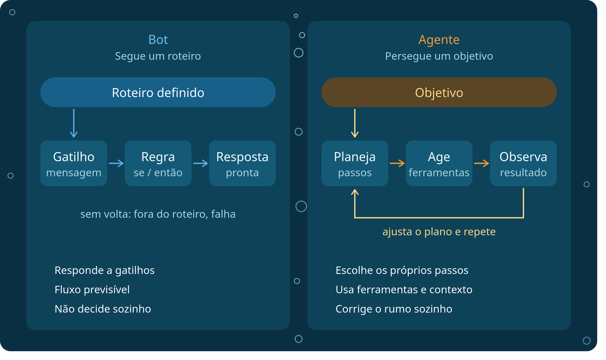
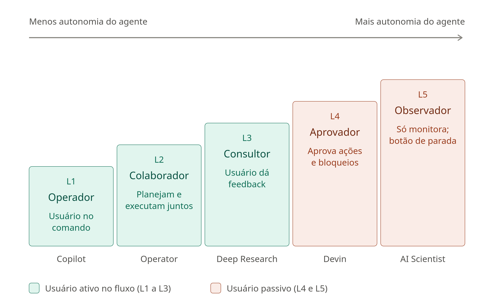

# Agentes + Visão Computacional

---

### 🛠️ Ferramentas Utilizadas

---

<div style="inline-flex">
<a href="https://colab.new" target="_blank"></a>


</div>

---

### 🤖 1. O que é um Agente de IA?

---

Nos **Dias 01 e 02**, aprendemos a manipular pixels e a utilizar modelos como o **YOLO** para detectar objetos em imagens e vídeos. Porém, um detector convencional apenas retorna dados brutos (caixas, classes e probabilidades). Como transformar essas detecções em **tomada de decisão e ação no mundo real**?

É aqui que entra o conceito de **Agente de IA**: um sistema que **observa** um ambiente, **processa** informações e **escolhe ações** para alcançar um objetivo específico.

```text
┌────────────┐    ┌───────────────┐    ┌─────────┐    ┌──────┐    ┌───────────┐
│ Observação │ ─► │ Interpretação │ ─► │ Decisão │ ─► │ Ação │ ─► │ Resultado │
└────────────┘    └───────────────┘    └─────────┘    └──────┘    └───────────┘
 (Imagem/Vídeo)    (YOLO + Regras)     (Política)     (Tools)     (Alerta/Log)
```

* **Combinação de técnicas:** Um agente pode combinar modelos de aprendizado de máquina (como redes neurais), regras de negócio e funções Python. **Nem todo agente precisa usar um Modelo de Linguagem (LLM)** — agentes baseados em regras ou políticas determinísticas são rápidos, previsíveis e amplamente usados na indústria.
* **Agente de Visão (*Vision Agent*):** Utiliza imagens ou vídeos como **observações** do ambiente. Enquanto um detector comum apenas lista os objetos identificados, o agente de visão usa essas detecções para escolher verificações adicionais, acionar ferramentas externas e decidir o próximo passo.

---

### ⚖️ 2. Bot vs. Agente e Níveis de Autonomia

---

#### Bot e Agente: qual é a diferença?

Um **bot** automatiza interações ou tarefas repetitivas, seguindo fluxos fixos acionados por comandos diretos ou gatilhos simples. Já um **agente** seleciona quais ações executar de acordo com o **objetivo** e as **observações** disponíveis no ambiente.

> **Importante:** Os conceitos não são excludentes! Um **bot** (como um bot do Telegram) pode fazer parte de um sistema **agente**, atuando como o canal de comunicação ou ferramenta de notificação do agente.



#### Níveis de Autonomia de Agentes de IA

Dependendo de quanto controle o humano mantém sobre o sistema e de como o agente planeja suas ações, podemos classificar os agentes em diferentes **níveis de autonomia**:



<p style="text-align: center;"> Artigo original: <a href="https://arxiv.org/html/2506.12469v1" target="_blank">Levels of Autonomy for AI Agents Working Paper.</a></p>

---

### 🔌 3. Model Context Protocol (MCP)

---

Quando construímos agentes que precisam acionar diversas funções (consultar bancos de dados, verificar sensores, analisar imagens ou enviar mensagens), integrar cada ferramenta manualmente pode se tornar confuso.

O **Model Context Protocol (MCP)** é um protocolo aberto que padroniza a forma como aplicações de IA descobrem e utilizam ferramentas (*tools*) e recursos disponibilizados por servidores compatíveis.

```text
┌───────────────────────────────────────────┐          ┌───────────────────────────┐
│               Host (Colab)                │          │       Servidor MCP        │
│  ┌─────────────────┐   ┌───────────────┐  │   MCP    │  • detectar_objetos()     │
│  │ Agente / Código │◄─►│  Cliente MCP  │◄─┼─────────►│  • contar_objetos()       │
│  └─────────────────┘   └───────────────┘  │          │  • verificar_condicao()   │
└───────────────────────────────────────────┘          │  • enviar_alerta()        │
                                                       └───────────────────────────┘
```

#### Componentes da Arquitetura MCP:

=== "Host (Anfitrião)"

    * **Papel:** É a aplicação principal que integra o modelo ou a política do agente e coordena toda a interação (por exemplo, o nosso notebook no Google Colab ou uma aplicação em produção).

=== "Cliente MCP"

    * **Papel:** Componente dentro do Host que mantém a conexão com o servidor MCP, consulta quais ferramentas estão disponíveis e solicita a execução de operações.

=== "Servidor MCP"

    * **Papel:** Expõe ferramentas padronizadas (como funções Python decoradas) para que o cliente possa chamá-las de forma segura e estruturada.

> **Atenção:** O MCP **não é um modelo de IA** e não escolhe sozinho quais ferramentas usar. A decisão sempre cabe ao **agente** (seja via regras em código ou via LLM). No Google Colab, cliente e servidor podem ser testados na mesma sessão utilizando um transporte compatível, como o transporte em memória do SDK.

---

### 💻 4. Prática: Vision Agent para Detectar Mudanças entre Imagens

---

Nesta prática final, vamos integrar tudo o que construímos no minicurso para criar um **Vision Agent completo**, capaz de inspecionar imagens com **YOLO + OpenCV**, tomar decisões com base nas detecções, acionar ferramentas via **MCP** e enviar alertas automáticos no **Telegram**!

#### Arquitetura do Projeto

```text
Imagem enviada ao Colab
        ↓
YOLO + OpenCV
        ↓
Detecções estruturadas
        ↓
Política de decisão do agente
        ↓
Cliente MCP ↔ Servidor MCP
        ↓
Ferramenta de verificação
        ↓
Regra de alerta
        ↓
Telegram Bot API
```

#### Ferramentas do Agente

Nosso servidor expõe quatro ferramentas fundamentais para o ciclo do agente:

- `detectar_objetos(imagem)`: executa o YOLO e retorna classes, confiança e coordenadas.
- `contar_objetos(deteccoes, classe)`: contabiliza quantas detecções pertencem a uma classe específica.
- `verificar_condicao(observacao)`: compara estados ou aplica uma regra definida para o cenário (ex.: mudança na cena ou presença não autorizada).
- `enviar_alerta(mensagem, chat_id)`: envia uma notificação em tempo real via Telegram Bot API.

#### Como o agente escolhe o que investigar?

=== "Versão Básica (Regras Determinísticas)"

    A versão padrão do nosso projeto utiliza **regras determinísticas em Python**:

    1. O agente observa a imagem (ou compara duas imagens: *antes* e *depois*).
    2. Se forem detectadas pessoas (`person`) ou uma variação na contagem de objetos da cena, a política do agente decide acionar a ferramenta de verificação `verificar_condicao(observacao)`.
    3. Em seguida, a regra de alerta avalia o resultado da verificação e decide se deve chamar `enviar_alerta()` para notificar o usuário no Telegram.

=== "Versão com LLM (Planejador Autônomo)"

    Um **Modelo de Linguagem (LLM)** pode substituir ou complementar esse planejador determinístico:

    * Em vez de `if/else` fixos, o LLM lê a lista de ferramentas do Servidor MCP e escolhe quais chamar com base no objetivo em linguagem natural e nos resultados das etapas anteriores.
    * Como essa opção exige acesso a um provedor de modelo e uma chave de API (`API Key`), ela é opcional e não é necessária para executar a versão básica do minicurso.

---

#### Passo 1: Instalação das Dependências

No Google Colab, instalamos o `ultralytics`, o SDK do `mcp` (ou `fastmcp`) e a biblioteca `requests` para comunicação com a API do Telegram.

```python
# No Google Colab, descomente a linha abaixo para instalar:
# !pip install -q ultralytics opencv-python matplotlib requests mcp

import cv2
import requests
from ultralytics import YOLO

# Carrega o modelo YOLO pré-treinado
modelo = YOLO('yolov8n.pt')
```

---

#### Passo 2: Definindo as Ferramentas de Visão e Verificação

Resgatamos as funções estruturadas do **Dia 02** e adicionamos a ferramenta de verificação de mudanças entre duas observações (ex.: imagem de referência vs. imagem atual) e o disparo de alerta para o Telegram.

```python
def detectar_objetos(caminho_ou_img, limite_confianca=0.5):
    """Retorna lista de dicionários com classe, confiança e coordenadas."""
    resultados = modelo.predict(source=caminho_ou_img, conf=limite_confianca, verbose=False)
    deteccoes = []

    for caixa in resultados[0].boxes:
        id_cls = int(caixa.cls[0])
        deteccoes.append({
            'classe': resultados[0].names[id_cls],
            'confianca': round(float(caixa.conf[0]), 3),
            'coordenadas': [int(v) for v in caixa.xyxy[0]]
        })
    return deteccoes


def contar_objetos(deteccoes, classe):
    """Conta as detecções de uma classe específica."""
    return sum(1 for obj in deteccoes if obj['classe'] == classe)


def verificar_condicao(observacao):
    """
    Aplica a regra do cenário: compara a contagem anterior com a atual
    e verifica se houve mudança relevante ou presença de pessoas.
    """
    antes = observacao.get('contagem_antes', 0)
    depois = observacao.get('contagem_depois', 0)
    classe = observacao.get('classe_monitorada', 'person')

    mudou = depois != antes
    diferenca = depois - antes

    return {
        'classe': classe,
        'mudanca_detectada': mudou,
        'diferenca': diferenca,
        'alerta_necessario': mudou and depois > 0,
        'resumo': f"Classe '{classe}': antes={antes}, agora={depois} (variação: {diferenca:+d})."
    }


def enviar_alerta(mensagem, token_bot, chat_id):
    """Envia uma mensagem para o Telegram usando a Bot API."""
    if not token_bot or not chat_id:
        print(f'[SIMULAÇÃO TELEGRAM] Mensagem que seria enviada:\n👉 {mensagem}')
        return {'ok': True, 'simulado': True}

    url = f'https://api.telegram.org/bot{token_bot}/sendMessage'
    payload = {'chat_id': chat_id, 'text': mensagem}
    resposta = requests.post(url, json=payload, timeout=10)
    return resposta.json()
```

---

#### Passo 3: Expondo as Ferramentas em um Servidor MCP

Com o `FastMCP` (parte do SDK oficial do MCP em Python), podemos registrar nossas funções como ferramentas padronizadas que qualquer cliente MCP ou LLM consegue descobrir e invocar:

```python
from mcp.server.fastmcp import FastMCP

# Cria o servidor MCP do nosso Agente de Visão
mcp_server = FastMCP('VisionAgentServer')

@mcp_server.tool()
def tool_detectar_objetos(caminho_imagem: str, confianca: float = 0.5) -> list:
    """Detecta objetos em uma imagem usando YOLO e retorna classes, confiança e coordenadas."""
    return detectar_objetos(caminho_imagem, limite_confianca=confianca)

@mcp_server.tool()
def tool_contar_objetos(deteccoes: list, classe: str) -> int:
    """Conta quantos objetos de uma determinada classe existem na lista de detecções."""
    return contar_objetos(deteccoes, classe)

@mcp_server.tool()
def tool_verificar_condicao(observacao: dict) -> dict:
    """Verifica se houve mudança relevante na cena monitorada."""
    return verificar_condicao(observacao)

@mcp_server.tool()
def tool_enviar_alerta(mensagem: str, token_bot: str = '', chat_id: str = '') -> dict:
    """Envia um alerta para o Telegram caso uma condição crítica seja confirmada."""
    return enviar_alerta(mensagem, token_bot, chat_id)
```

---

#### Passo 4: Executando o Ciclo Completo do Agente

Agora unimos todas as etapas no ciclo **Observação → Interpretação → Decisão → Ação → Resultado**:

```python
def executar_vision_agent(
    img_referencia,
    img_atual,
    classe_alvo='person',
    telegram_token='',
    telegram_chat_id=''
):
    print('1. [OBSERVAÇÃO] Analisando imagens com YOLO...')
    det_antes = tool_detectar_objetos(img_referencia)
    det_depois = tool_detectar_objetos(img_atual)

    print('2. [INTERPRETAÇÃO] Contabilizando objetos da classe:', classe_alvo)
    qtd_antes = tool_contar_objetos(det_antes, classe_alvo)
    qtd_depois = tool_contar_objetos(det_depois, classe_alvo)

    observacao = {
        'classe_monitorada': classe_alvo,
        'contagem_antes': qtd_antes,
        'contagem_depois': qtd_depois
    }

    print('3. [DECISÃO] Acionando ferramenta de verificação de condição...')
    verificacao = tool_verificar_condicao(observacao)
    print('   Resultado da verificação:', verificacao['resumo'])

    print('4. [AÇÃO] Avaliando regra de alerta...')
    if verificacao['alerta_necessario']:
        msg = (
            f"🚨 ALERTA DO VISION AGENT!\n"
            f"Mudança detectada na cena monitorada.\n"
            f"{verificacao['resumo']}"
        )
        resultado_envio = tool_enviar_alerta(msg, telegram_token, telegram_chat_id)
        print('5. [RESULTADO] Alerta processado com sucesso!', resultado_envio)
    else:
        print('5. [RESULTADO] Nenhuma anomalia crítica. Nenhum alerta enviado.')


# Teste rápido comparando duas cenas
url_cena_1 = 'https://ultralytics.com/images/zidane.jpg'
url_cena_2 = 'https://ultralytics.com/images/bus.jpg'

executar_vision_agent(
    img_referencia=url_cena_1,
    img_atual=url_cena_2,
    classe_alvo='person'
)
```

<p style="text-align: center; margin-top: 24px;">
<a style="font-size:2vh; background-color: #06e4d9 !important; padding: 10px 18px; border-radius: 6px; color: #000; font-weight: bold; text-decoration: none;" href="https://google.com" target="_blank">Clique aqui para abrir o projeto no Colab</a>
</p>

---

### 💭 Para ir mais a fundo...

---

#### 📚 Materiais e artigos sugeridos

* <a href="https://arxiv.org/html/2506.12469v1" target="_blank">Levels of Autonomy for AI Agents — Working Paper (arXiv)</a>
* <a href="https://modelcontextprotocol.io/" target="_blank">Documentação Oficial do Model Context Protocol (MCP)</a>
* <a href="https://core.telegram.org/bots/api" target="_blank">Documentação Oficial da Telegram Bot API</a>

#### 🤖 Prompts para estudar com LLMs

Copie e cole os prompts abaixo no seu assistente de IA favorito para aprofundar os conceitos vistos na aula:

1. **Arquitetura de Agentes de Visão (Regras vs. LLMs):**
   > *"Explique a diferença entre um pipeline tradicional de Visão Computacional (que apenas executa um modelo como YOLO) e um Agente de Visão (Vision Agent) que segue o ciclo Observação → Interpretação → Decisão → Ação. Compare quando vale a pena usar uma política de decisão baseada em regras determinísticas em Python e quando vale a pena usar um LLM como planejador."*

2. **Model Context Protocol (MCP) na Prática:**
   > *"Explique de forma didática o que é o Model Context Protocol (MCP), qual problema ele resolve no desenvolvimento de agentes de IA e qual é o papel do Host, do Cliente MCP e do Servidor MCP. Mostre um exemplo simples em Python usando FastMCP expondo duas ferramentas."*

3. **Integrando Visão Computacional com Bot do Telegram:**
   > *"Como criar um bot no Telegram usando o @BotFather, obter o Token e o Chat ID, e enviar tanto mensagens de texto quanto imagens anotadas pelo OpenCV/YOLO em Python usando a biblioteca requests? Mostre o código passo a passo e explique boas práticas para evitar enviar múltiplos alertas repetidos em vídeos."*
